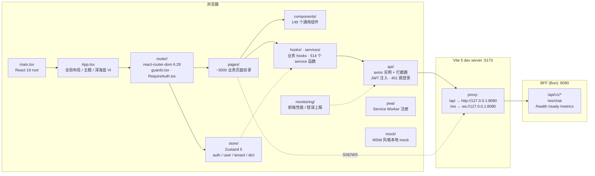

# 健澜AI原生医院操作系统OS — 开发者指南


> 仓库视角：**GitHub `JLAIharnessos` 开发者镜像**。本文件面向前端工程师、二次开发伙伴与集成商，聚焦 `web/` 工作台、Vite 构建、部署运维与二次开发 checklist。
> 后端 BFF / AI 编排 / 数据底座的工程文档见 [`README.md`](./README.md)（GitCode `JLMEDAIOS` 主仓视角）。

---

## 1. 开发者入口

这套工作台是健澜AI原生医院操作系统OS 的前端壳。它本身不写业务逻辑——所有数据、权限、AI 流式输出都来自同源 BFF（`/api/v1/*`、`/ws/chat`）。前端的职责是：

- 把 BFF 暴露的 ~300+ 业务路由组织成可导航的工作台（医生站、护士站、科主任驾驶舱、院长 BI、系统管理、AI 工作台、FHIR 网关调试台等）；
- 用 React 19 + Vite 5 + Ant Design 5 + Zustand 5 提供三甲医院级别的 UI/UX；
- 通过 Vite dev proxy 在本地把 `/api`、`/ws` 透明转发到 `127.0.0.1:8080` 的 Bun BFF；
- 用 `@xyflow/react` 提供低代码智能体编排画布，用 ECharts 5 提供全院驾驶舱。

如果你是：

- **前端工程师**：从第 4 节"快速开始前端"开始，按第 9 节 checklist 加一个业务模块。
- **二次开发伙伴 / 集成商**：从第 7 节"构建与部署"开始，重点看 docker-compose 与 `deploy/` 目录。
- **AI / Agent 开发者**：先读 [`README.md`](./README.md) 第 4 节 `orchestrator/` 与 `medical-tools/`，再回到本仓库第 6 节"权限与路由"。

---

## 2. 前端架构



分层约定：

| 层 | 目录 | 职责 |
|---|---|---|
| 入口 | `main.tsx`、`App.tsx`、`config.ts` | React root、全局 Provider、环境变量读取 |
| 路由 | `router/` | 声明式路由表、`RequireAuth` 守卫、`guards.tsx` 权限码校验、`outpatientRoutes.tsx` 门诊域子路由 |
| 页面 | `pages/<domain>/` | 一个业务一个目录，目录名即路由段；`index.tsx` 为默认导出 |
| 组件 | `components/` | 跨业务复用组件（深海蓝 VI 主题、表格、图表、AI 对话面板） |
| API | `api/` | axios 实例、请求/响应拦截器、错误归一化 |
| Service | `services/` | 按业务域封装的 API 调用函数（页面不直接写 axios） |
| Store | `store/` | Zustand 切片：auth、user、tenant、dict、app-shell |
| Hooks | `hooks/` | 通用 hooks（useAuth、useDict、usePermission、useWs） |
| 监控 | `monitoring/` | 前端性能指标、错误边界、Sentry 上报 |
| PWA | `pwa/` | Service Worker 注册与更新提示 |
| Mock | `mock/` | 本地无 BFF 时的演示数据 |

---

## 3. `web/src` 模块地图

| 目录 | 文件数 | 说明 |
|---|---:|---|
| `router/` | 4 | `index.tsx`（路由表）、`RequireAuth.tsx`（登录守卫）、`guards.tsx`（权限码守卫）、`outpatientRoutes.tsx`（门诊域子路由） |
| `pages/` | 3173 | 业务页面目录，按域划分：`emr/`、`nursing/`、`pharmacy/`、`surgery/`、`emergency/`、`cds/`、`ai-brain/`、`muse-*`、`internet-hospital/`、`fhir/`、`admin/`、`superadmin/`、`tenant/`、`consult-agent/` 等 |
| `components/` | 149 | 通用组件：布局、深海蓝 VI 主题、AI 对话面板、ECharts 封装、低代码画布（基于 `@xyflow/react`） |
| `api/` | 6 | axios 实例、拦截器、类型化请求封装 |
| `services/` | 514 | 按业务域拆分的 API 调用函数 |
| `store/` | 508 | Zustand 切片（auth / user / tenant / dict / app-shell / 工作台待办） |
| `hooks/` | 4 | `useAuth`、`usePermission`、`useDict`、`useWs` |
| `monitoring/` | 1 | 前端性能与错误上报入口 |
| `pwa/` | 2 | Service Worker 注册 |
| `mock/` | 22 | 本地 mock 数据 |

---

## 4. 快速开始前端

前置：

- Node ≥ 18（推荐 20 LTS）；
- 仓库根已 `bun install`（前端依赖在 `web/node_modules`，由 `bun install` 一并安装）；
- BFF 已在 `127.0.0.1:8080` 启动（可先 `DEMO_MODE=1` 跑起来，见 [`README.md`](./README.md) 第 7 节）。

```powershell
cd C:\Users\lenovo\Doubao\chats\2026-09-14\new-chat-1\web

# 安装前端依赖（首次；后续根目录 bun install 已覆盖）
bun install

# 启动 Vite dev server
bun run dev
```

Vite 默认监听 `http://0.0.0.0:5173`：

```text
  VITE v5.x  ready in 300 ms
  ➜  Local:   http://127.0.0.1:5173/
  ➜  Network: http://192.168.x.x:5173/
```

打开 `http://127.0.0.1:5173/`，前端会把 `/api/*` 与 `/ws/*` 透明代理到 `127.0.0.1:8080`。

常用脚本（`web/package.json`）：

| 命令 | 作用 |
|---|---|
| `bun run dev` | Vite dev server（HMR） |
| `bun run build` | `tsc --noEmit && vite build`，产物到 `web/dist/` |
| `bun run build:analyze` | 同上 + rollup visualizer 输出 `dist/stats.html` |
| `bun run preview` | 本地预览 `dist/` |
| `bun run typecheck` | `tsc --noEmit`（web 目录） |
| `bun run lint` / `bun run lint:fix` | ESLint |
| `bun run test` / `bun run test:watch` / `bun run test:coverage` | Vitest 单测 |
| `bun run test:e2e` / `bun run test:e2e:ui` | Playwright 端到端 |

---

## 5. 与后端 BFF 的对接

Vite 代理配置（`web/vite.config.ts`）：

```ts
server: {
  host: '0.0.0.0',
  port: 5173,
  proxy: {
    '/api': {
      target: process.env.VITE_PROXY_TARGET || 'http://127.0.0.1:8080',
      changeOrigin: true,
    },
    '/ws': {
      target: process.env.VITE_WS_PROXY_TARGET || 'ws://127.0.0.1:8080',
      ws: true,
      changeOrigin: true,
    },
  },
},
```

约定：

- **API 前缀**：所有业务接口走 `/api/v1/*`，前端 `api/` 实例的 `baseURL` 即 `/api/v1`。
- **WebSocket**：AI 流式对话与危急值广播走 `/ws/chat`，前端 `useWs` hook 自动重连。
- **鉴权头**：登录后 BFF 返回 JWT，前端 axios 拦截器自动注入 `Authorization: Bearer <token>`；401 时清空 store 并跳 `/login`。
- **CSRF**：写操作需带 `X-CSRF-Token`（BFF `middleware/csrf` 校验），首次 GET 后由 cookie 下发。
- **租户**：`X-Tenant-Id` 由 BFF 从 JWT 解析，前端不手动传。
- **生产同源**：`docker-compose.yml` 中 `web` 镜像以 `VITE_API_BASE_URL=/api/v1`、`VITE_WS_URL=/ws` 构建，由 nginx edge 同域反代到 BFF，无跨域问题。

切换 BFF 地址：

```powershell
$env:VITE_PROXY_TARGET = "http://10.0.0.8:8080"
$env:VITE_WS_PROXY_TARGET = "ws://10.0.0.8:8080"
bun run dev
```

---

## 6. 权限与路由

三方一致性约束（改任何一边都要同步另外两边）：

1. **BFF 权限码**：`src/bff/permissions.ts` 与 `src/security/` 定义 RBAC + ABAC 策略，12 种角色；写操作在路由层 `requireRole(...)` 校验。
2. **前端路由守卫**：`web/src/router/guards.tsx` 在进入页面前校验用户是否持有该路由所需权限码；无权限渲染 403 占位。
3. **菜单**：`web/src/components/` 中的侧边菜单按权限码过滤，无权限的菜单项不渲染（而不是渲染后 403）。

新增一个需要权限的页面时，权限码必须：

- 在 BFF 路由 `requireRole` / `requirePermission` 中声明；
- 在前端 `router/guards.tsx` 的路由 meta 中声明；
- 在菜单配置中按权限码注册。

三者缺一不可，否则会出现"菜单看不见但 URL 直进能进"或"菜单看得见但接口 403"的不一致。

---

## 7. 构建与部署

### 7.1 本地生产构建

```powershell
cd C:\Users\lenovo\Doubao\chats\2026-09-14\new-chat-1\web
bun run build
# 产物：web/dist/（静态资源，由 nginx 托管）
```

Vite 构建分包策略（`vite.config.ts` `manualChunks`）：

- `react-vendor`：react / react-dom / react-router-dom
- `antd-vendor`：antd / @ant-design/icons
- `echarts-vendor`：echarts / echarts-for-react
- `utils`：axios / dayjs / lodash-es / clsx / zustand

### 7.2 Docker Compose 全栈

```powershell
# 仓库根
Copy-Item .env.compose.example .env
# 编辑 .env：替换所有 CHANGE_ME / 占位符口令

docker compose build
docker compose up -d
```

默认拓扑（`docker-compose.yml`）：

| 服务 | 容器内端口 | 宿主机绑定 | 说明 |
|---|---|---|---|
| `nginx`（edge） | `:8080`（HTTP）/ `:8443`（HTTPS） | `${HTTP_PORT:-80}`、`${HTTPS_PORT:-443}` | 唯一对外入口 |
| `app`（BFF） | `:8080` | `127.0.0.1:${APP_PORT:-8080}` | Bun 运行时，非 root `bunapp` uid=10001 |
| `web`（前端静态） | `:8080`（nginx） | 不直接暴露 | 由 edge 反代 |
| `postgres` | `:5432` | `127.0.0.1:${POSTGRES_PORT:-5432}` | PG 16.4 |
| `redis` | `:6379` | `127.0.0.1:${REDIS_PORT:-6379}` | Redis 7.4 |
| `kafka` | `:9092` | `127.0.0.1:${KAFKA_PORT:-9092}` | KRaft 单节点 |
| `elasticsearch` | `:9200` | `127.0.0.1:${ES_PORT:-9200}` | 日志检索 |
| `kibana` | `:5601` | `127.0.0.1:${KIBANA_PORT:-5601}` | 日志 UI |
| `prometheus` | `:9090` | `127.0.0.1:${PROMETHEUS_PORT:-9090}` | 指标采集 |
| `grafana` | `:3000` | `127.0.0.1:${GRAFANA_PORT:-3000}` | 看板 |
| `alertmanager` | `:9093` | `127.0.0.1:${ALERTMANAGER_PORT:-9093}` | 告警分发 |
| `jaeger` | `:16686` | `127.0.0.1:${JAEGER_PORT:-16686}` | 链路追踪 UI |
| `postgres-exporter` | `:9187` | `127.0.0.1:${PG_EXPORTER_PORT:-9187}` | PG 指标 |
| `redis-exporter` | `:9121` | `127.0.0.1:${REDIS_EXPORTER_PORT:-9121}` | Redis 指标 |

生产覆盖：

```powershell
docker compose -f docker-compose.yml -f docker-compose.prod.yml up -d
```

旁路服务（不随默认 profile 启动）：

```powershell
# AI 影像辅诊（DAMO-RADAR，FastAPI :8090）
docker compose --profile demo up -d radar-inference
# Java 模块化单体 / Python FastAPI 参考实现
docker compose --profile legacy up -d jlmedaios-monolith jlmedaios-ai
```

### 7.3 镜像

- 后端：`Dockerfile.backend`（多阶段，`oven/bun:1.4.2-slim`，非 root）。
- 前端：`web/Dockerfile.frontend`（多阶段构建 Vite 产物，nginx 托管）。
- 边缘：`deploy/nginx/Dockerfile`。
- Helm / K8s 清单：`deploy/helm/`、`deploy/k8s/`。

---

## 8. 可观测性

| 端点 | 位置 | 用途 |
|---|---|---|
| `GET /health` | BFF | 存活探针（liveness） |
| `GET /ready` | BFF | 就绪探针（readiness，探测 PG/Redis） |
| `GET /metrics` | BFF | Prometheus 指标文本 |
| `GET /api/v1/health` | BFF | 业务层健康（含依赖版本） |
| `GET /healthz` | nginx edge / web | 边缘存活 |
| Grafana | `http://127.0.0.1:3000` | 看板（`deploy/grafana/dashboards/` 预置） |
| Prometheus | `http://127.0.0.1:9090` | 指标查询 |
| Jaeger | `http://127.0.0.1:16686` | 链路追踪 |
| Kibana | `http://127.0.0.1:5601` | 日志检索 |

前端监控代码在 `web/src/monitoring/`，错误上报走 `SENTRY_DSN`（生产配置）。

---

## 9. 二次开发指南：新增一个业务模块 Checklist

以"新增一个科室会议管理模块"为例，按顺序完成：

1. **BFF 路由**：在 `src/bff/routes/` 新建 `meeting.ts`，导出 `meetingRoutes`，在 `src/bff/server.ts` 中 `app.route('/api/v1/meetings', meetingRoutes)`。
2. **BFF 权限**：在路由处理函数上加 `requireRole(['doctor','dept_head'])`；写操作加 `withIdempotency` 与 `auditOperation`。
3. **前端 service**：在 `web/src/services/meeting.ts` 写 `listMeetings()`、`createMeeting()` 等函数，调用 `api.get/post('/meetings')`。
4. **前端页面**：在 `web/src/pages/meeting/` 新建 `index.tsx`（列表）、`detail.tsx`（详情），默认导出组件。
5. **前端路由**：在 `web/src/router/index.tsx` 注册路径 `/meeting`，meta 中标注所需权限码。
6. **前端守卫**：确认 `router/guards.tsx` 能识别该权限码。
7. **菜单**：在侧边菜单配置中按权限码注册菜单项。
8. **类型**：在 `web/src/types/` 补 `Meeting` 类型；BFF 侧在 `src/<domain>/types.ts` 补对应类型。
9. **测试**：BFF 写 `tests/unit/meeting.test.ts`；前端写 `web/src/services/__tests__/meeting.test.ts`（Vitest）。
10. **双 tsc 门禁**：根目录与 web 目录分别跑通（见第 11 节）。
11. **可观测**：新路由自动进入 `/metrics` 的 `http_requests_total{route="/api/v1/meetings"}` 标签。

---

## 10. 技术栈与版本

| 类别 | 选型 | 版本 |
|---|---|---|
| 框架 | React + React DOM | `^19.0.0` |
| 路由 | react-router-dom | `^6.28.0` |
| 构建 | Vite（`@vitejs/plugin-react`） | `^5.x`（devDep） |
| 语言 | TypeScript | `~5.6.3`（web 目录，与根 `6.0.2` 并存） |
| UI 组件库 | Ant Design + @ant-design/icons + v5-patch-for-react-19 | `^5.22.2` / `^5.5.1` / `^1.0.3` |
| 样式 | Tailwind CSS + PostCSS + autoprefixer | `^3.4.15` |
| 状态管理 | Zustand | `^5.0.1` |
| 数据请求 | axios | `^1.7.9` |
| 可视化 | ECharts + echarts-for-react | `^5.5.1` / `^3.0.2` |
| 流程编排画布 | @xyflow/react | `^12.11.6` |
| 工具库 | lodash-es、dayjs、clsx、yaml | `^4.17.21` / `^1.11.13` / `^2.1.1` / `^2.9.1` |
| 二维码 | qrcode.react | `^4.2.0` |
| 单测 | Vitest + @vitest/coverage-v8 + jsdom + Testing Library | `^2.1.8` |
| E2E | Playwright | `^1.48.2` |
| Git 钩子 | husky + lint-staged | `^9.1.7` / `^15.2.10` |
| 包管理 | Bun（与根 `packageManager: bun@1.4.2` 对齐） | — |

---

## 11. 常见问题（FAQ）

### Q1：双 tsc 门禁怎么跑？

本仓库根目录与 `web/` 各有一份 TypeScript，版本不同（根 `6.0.2`，web `~5.6.3`），必须分别跑通：

```powershell
# 根目录（后端 BFF）——必须用 node 调 typescript，不要用 npx
cd C:\Users\lenovo\Doubao\chats\2026-09-14\new-chat-1
node node_modules/typescript/bin/tsc --noEmit

# web 目录（前端）
cd C:\Users\lenovo\Doubao\chats\2026-09-14\new-chat-1\web
bun x tsc --noEmit
```

**禁止**：在仓库根或 web 目录直接跑 `npx tsc`——会拉到错误版本或污染 lockfile。

### Q2：bun 不在 PATH？

用全路径：

```powershell
C:\Users\lenovo\.bun\bin\bun.exe install
C:\Users\lenovo\.bun\bin\bun.exe run dev
```

或把 `C:\Users\lenovo\.bun\bin` 加入用户 PATH 后重开终端。

### Q3：前端起不来，报 `/api/v1/...` 502？

BFF 没起。先在仓库根跑：

```powershell
$env:DEMO_MODE = "1"
bun run src/bff/server.ts
```

确认 `http://127.0.0.1:8080/health` 返回 200 后再启动 Vite。

### Q4：JWT 过期 / 401 循环跳转？

清空浏览器 localStorage 后重新登录；开发环境可在 `web/src/api/` 拦截器里临时打印 token 排查。

### Q5：如何对接真实医院的 HIS/EMR/LIS/PACS？

在 `.env` 配置 `HIS_BASE_URL`、`EMR_BASE_URL`、`LIS_BASE_URL`、`PACS_BASE_URL` 与对应 API Key；前端无需改动，BFF `src/integration/` 适配器负责协议转换。

### Q6：如何关闭 Vite 代理，直连远程 BFF？

```powershell
$env:VITE_PROXY_TARGET = "https://hospital.example.com"
$env:VITE_WS_PROXY_TARGET = "wss://hospital.example.com"
bun run dev
```

---

## 12. 贡献指南

- 贡献流程：[`CONTRIBUTING.md`](./CONTRIBUTING.md)。
- 行为准则：[`CODE_OF_CONDUCT.md`](./CODE_OF_CONDUCT.md)。
- 安全披露：[`SECURITY.md`](./SECURITY.md)（请勿公开 Issue 上报漏洞）。
- 提交前自检：

```powershell
# 根目录
node node_modules/typescript/bin/tsc --noEmit
bun run lint:ci
bun test

# web 目录
cd web
bun x tsc --noEmit
bun run lint
bun run test
```

- 当前工作分支：**`consult-agent-m86`**。日常开发推 GitCode 主仓；GitHub `JLAIharnessos` 镜像由 CI 单向同步，不要直接 `git push origin heagentos`。

Copyright © 2026 杭州健澜科技有限公司. All rights reserved.
