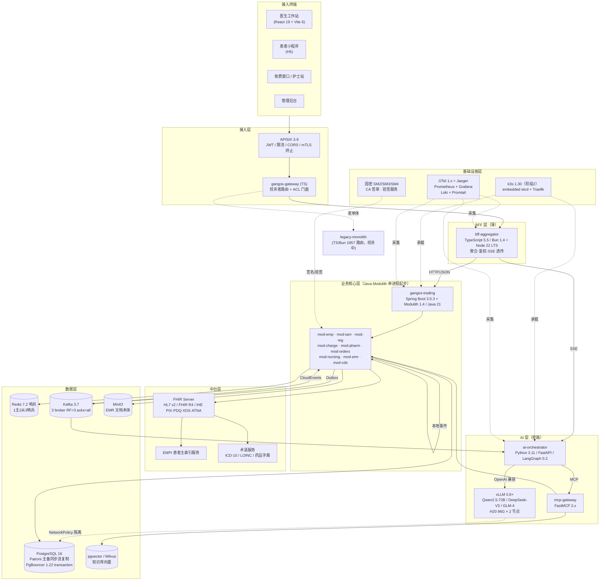

# 健澜AI原生医院操作系统OS 重构 · 02-技术架构

> 本文档基于《00-决策基线 v1.0》（2026-10-19）撰写，是 B 轨（Java 核心域重构）与 A 轨（Python AI 层）统一的技术架构蓝本。
> 所有版本号、容量参数、硬约束均以决策基线为唯一事实来源；与本文件冲突时，以决策基线为准。
> 适用读者：架构组、Java/Python/TS 三端 Tech Lead、运维 SRE、医疗 Domain Expert。

---

## 1. 总体架构

### 1.1 一句话架构

**双轨并行、模块化单体起步、AI 旁路造血、绞杀者渐进替换。** 外层由 APISIX 统一接入，中层是薄 BFF（TypeScript/Bun+Node 双运行时），核心交易域以 Spring Boot 3.5.3 + Spring Modulith 1.4（Java 21）单进程多模块承载，AI 推理由独立 Python FastAPI + vLLM 本地节点承担，数据层统一走 PostgreSQL 16（信创目标达梦 8）+ Redis 7.2 哨兵 + Kafka 3.7，中台 FHIR Server / EMPI / 术语服务独立部署以满足互联互通四甲举证。

### 1.2 总体架构图（Mermaid）



### 1.3 ASCII 拓扑（部署视角）

```
                        [医院内网 / 等保三级域]
  ┌─────────────┐   ┌─────────────┐   ┌─────────────┐
  │ 医生工作站    │   │ 患者小程序   │   │ 收费窗口     │
  └──────┬──────┘   └──────┬──────┘   └──────┬──────┘
         └────────────────┼────────────────┘
                          ▼
              ┌───────────────────────┐
              │  APISIX 3.9 (×2+VIP)   │  ← JWT / 限流 / mTLS / 国密 TLS
              └───────────┬───────────┘
                          ▼
              ┌───────────────────────┐
              │  gangos-gateway (TS)   │  ← 绞杀者路由 + ACL
              └──┬─────────┬──────────┘
                 │         │
        新流量 ▼         ▼ 老流量（逐步下线）
   ┌────────────────┐   ┌──────────────────┐
   │ bff-aggregator │   │ legacy-monolith  │
   │  (TS/Bun×4)    │   │ (TS/Bun 1957 路由)│
   └───────┬────────┘   └──────────────────┘
           │
     ┌─────┴──────┬─────────────┬──────────────┐
     ▼            ▼             ▼              ▼
 ┌────────┐  ┌────────┐   ┌──────────┐   ┌──────────┐
 │gangos- │  │ ai-    │   │ FHIR     │   │ mcp-     │
 │trading │  │orchest-│   │ Server   │   │ gateway  │
 │(Java×6)│  │rator  │   │ (Java)   │   │ (Python) │
 │Modulith│  │(Py×2)  │   │          │   │          │
 └───┬────┘  └───┬────┘   └────┬─────┘   └────┬─────┘
     │           │              │              │
     ▼           ▼              ▼              ▼
  PG(Patroni) Redis(Kafka) vLLM×2(GPU)  MinIO  pgvector
```

---

## 2. 逻辑分层

### 2.1 七层划分

| 层 | 职责 | 技术选型 | 关键约束 |
|---|---|---|---|
| **接入层** | 统一入口、TLS 终止（GMSSL）、JWT 校验、全局限流、IP 黑白名单、mTLS 证书签发 | APISIX 3.9（×2 + Keepalived VIP） | 禁止在接入层写业务逻辑；插件只启用官方 + 国产审计插件 |
| **BFF 层** | 协议转换、视图聚合、租户/数据范围注入、SSE 流式透传、鉴权上下文 | TypeScript 5.5 / Bun 1.4 + Node 22 LTS | **薄 BFF**：行内 SQL 数=0、禁止直连 DB、禁止 `bun:*` 模块 |
| **业务微服务层（Java Modulith）** | 挂号/收费/药房/医嘱/护理/EMR/CDS 等核心交易 | Spring Boot 3.5.3 + Modulith 1.4 + Java 21 | 单进程多模块起步，跨模块走本地事件；第 3 个模块独立扩缩容时才拆进程 |
| **AI 层（Python）** | 病历质控、AI 导诊、辅助问诊、CDS 推荐、Agent 编排 | FastAPI 0.115 + Pydantic v2 + Uvicorn + LangGraph 0.2 + vLLM 0.6 | 旁路模式不碰主流程；节点 NetworkPolicy 隔离，禁直连 PHI 生产库 |
| **中台层** | FHIR R4 服务、EMPI 患者主索引、ICD-10/LOINC 术语、IHE 互操作 | Java 17+ / HAPI FHIR 6.x | 独立部署，不能被 Kafka/APISIX 替代；互联互通四甲必配 |
| **数据层** | 关系库、缓存、消息、对象存储、向量库 | PG 16 + Redis 7.2 哨兵 + Kafka 3.7 + MinIO + pgvector | 方言抽象，PG→达梦 8 可迁移；EMR 文档本体入 MinIO |
| **基础设施层** | 容器编排、可观测性、密钥/国密、离线镜像仓库 | k3s 1.30 + OTel 1.x + Jaeger + Prom/Grafana + Loki + Harbor | 阶段 0/1 用 docker-compose+systemd，阶段 2 才上 k3s；12 个月内禁 Istio |

### 2.2 分层调用规则

1. **只能从上往下依赖**：接入层 → BFF → 业务层 / AI 层 → 中台层 → 数据层。禁止跨层直连（如 BFF 直连 PG、AI 直连业务库）。
2. **横向调用必须显式**：Java 模块之间通过 `mod-shared-api` 接口 + Spring ApplicationEvent 本地事件；进程化后通过 OpenFeign + Nacos。
3. **异步优先**：跨域写操作（挂号→收费→药房）一律走 Kafka CloudEvents，同步路径只查不写。
4. **AI 与业务解耦**：AI 层只通过 MCP Gateway 调用业务只读工具，绝不直接写交易表。

---

## 3. 服务划分清单

依据决策基线 §2.6 与评审 §3.6，按迁移批次展开。每个服务标注职责、接口数量预估、依赖、DB schema 归属、迁移批次。

### 3.1 批次总览

| 批次 | 时间窗 | 服务 | 语言形态 |
|---|---|---|---|
| 批次 0（A 轨先行） | M0–M3 | bff-aggregator、ai-orchestrator、mcp-gateway、FHIR Server | TS / Python / Java |
| 批次 1（B 轨 M1–M6） | M1–M6 | patient-master(EMPI)、registration、outpatient-charge | Java Modulith |
| 批次 2（M6–M12） | M6–M12 | orders、pharmacy、nursing | Java Modulith → 独立部署 |
| 批次 3（M12–M18） | M12–M18 | emr-core、cds | Java Modulith |
| 中台（并行） | M3–M12 | FHIR Server、EMPI、term-service | Java |
| 平台域 | M1–M6 | iam（RBAC/租户/MFA/审计） | Java Modulith |

### 3.2 服务逐项展开

#### 3.2.1 bff-aggregator（薄 BFF）
- **职责**：REST 聚合、JWT 鉴权上下文注入、SSE 透传 AI 流式输出、多下游并行编排、租户路由。
- **接口数量预估**：对外 ~120 个路由（绞杀期从老单体 1957 路由逐步收敛，目标 ≤150）。
- **依赖**：APISIX、Java 各服务（HTTP）、ai-orchestrator（SSE）、Redis（会话/黑名单）。
- **DB schema**：**不持有任何库表**，仅写 Redis 会话。
- **迁移批次**：批次 0 保留并持续瘦身；ESLint 强制行内 SQL=0。

#### 3.2.2 gangos-trading（Java 模块化单体）
- **职责**：承载批次 1–3 全部核心交易模块，单进程多模块，跨模块本地事件。
- **接口数量预估**：内部模块 API ~260 个；对外 REST ~180 个。
- **依赖**：PG（经 PgBouncer 6432）、Redis、Kafka、Nacos（阶段 2 后）、Sentinel 控制台、FHIR Server。
- **DB schema**：初期共享 `trading` 库（绞杀期 Shared Database），稳定后按模块拆 schema：`reg` / `charge` / `pharm` / `ord` / `nur` / `emr`。
- **迁移批次**：M1 启动，M18 完成模块化；第 3 个模块（预计 orders）独立扩缩容时拆进程。

#### 3.2.3 mod-emp（patient-master / EMPI）
- **职责**：患者主索引、就诊号分配、跨院患者匹配（IHE PIX/PDQ 依据）、患者基本信息只读视图。
- **接口预估**：~35 个（建卡、查档、合并、比对、就诊号生成）。
- **依赖**：FHIR Server、术语服务、PG schema `emp`。
- **DB schema**：`emp.patient_master`、`emp.patient_merge_log`、`emp.visit_identity`。
- **迁移批次**：批次 1 最先切出（所有域的依赖底座）。

#### 3.2.4 mod-reg（挂号 registration）
- **职责**：号源管理、预约、挂号提交、退号、当日限号、专家/普通号源字典。
- **接口预估**：~45 个（峰值 QPS 3000，P99<200ms）。
- **依赖**：mod-emp、mod-iam（权限）、Redis（号源缓存+分布式锁）、Kafka（`reg.order.booked` 事件）。
- **DB schema**：`reg.schedule`、`reg.order`（按月 RANGE 分区）、`reg.source_pool`。
- **迁移批次**：批次 1。容量：6 Pod × 4C8G，HikariCP ≤15/实例。

#### 3.2.5 mod-charge（outpatient-charge）
- **职责**：门诊收费、结算、电子票据、医保对接（CHS）、DRG/DIP 分组入口、退费。
- **接口预估**：~50 个。
- **依赖**：mod-reg、mod-emp、medical-insurance 独立服务、Kafka（`charge.paid` 事件）。
- **DB schema**：`charge.bill`、`charge.settlement`、`charge.invoice`、`charge.insurance_log`。
- **迁移批次**：批次 1。容量：4 Pod × 4C8G，HikariCP ≤15/实例。
- **硬规则**：医保外呼必须熔断（100 QPS/实例，错误率>50% 持续 10s 熔断 30s），降级为"先自费后追溯退费"。

#### 3.2.6 medical-insurance（医保独立服务）
- **职责**：CHS 接口适配、医保电子凭证、DRG/DIP 分组器、结算对账异步化。
- **接口预估**：~25 个。
- **依赖**：mod-charge、医保专线网关。
- **DB schema**：`ins.insurance_transaction`、`ins.reconcile_log`。
- **迁移批次**：批次 2。**独立进程**（外部依赖强、故障域隔离）。

#### 3.2.7 mod-orders（医嘱）
- **职责**：医嘱开立、审核、执行、停止；药品/检查/治疗/手术医嘱多态。
- **接口预估**：~60 个。
- **依赖**：mod-emp、mod-pharm、mod-cds、Kafka。
- **DB schema**：`ord.order_main`（按科室哈希分 8 表）、`ord.order_item`、`ord.execute_log`。
- **迁移批次**：批次 2，首个独立部署的 Java 模块（触发 Spring Cloud Alibaba 引入）。

#### 3.2.8 mod-pharmacy（药房）
- **职责**：审方、发药、退药、库存、药品字典、处方点评。
- **接口预估**：~40 个。
- **依赖**：mod-orders、mod-emp、Kafka（消费 `charge.paid` 预配药）。
- **DB schema**：`pharm.dispense`、`pharm.stock`、`pharm.drug_dict`（全量入 Caffeine+Redis）。
- **迁移批次**：批次 2。

#### 3.2.9 mod-nursing（护理）
- **职责**：护理记录、交班、风险评估（压疮/跌倒）、护理执行单。
- **接口预估**：~35 个。
- **依赖**：mod-orders、mod-emr（共享病历库）。
- **DB schema**：`nur.record`、`nur.shift_handover`。
- **迁移批次**：批次 3，初期共享 emr 库。

#### 3.2.10 mod-emr（电子病历核心）
- **职责**：病历文书、结构化解析、append-only 版本链、哈希链、CA 签章、质控规则。
- **接口预估**：~55 个。
- **依赖**：mod-emp、mod-orders、MinIO（文档本体）、验签服务。
- **DB schema**：`emr.document_meta`、`emr.document_version`（append-only）、`emr.hash_chain`。
- **迁移批次**：批次 3。容量：3 Pod × 4C8G，HikariCP ≤10/实例。

#### 3.2.11 mod-cds（临床决策支持）
- **职责**：药物相互作用、过敏提示、剂量校验、指南推荐（仅"提示/建议"，最终医嘱医生确认——规避 SaMD II/III 类）。
- **接口预估**：~20 个。
- **依赖**：mod-orders、ai-orchestrator（异步推荐）、term-service。
- **DB schema**：`cds.rule`、`cds.advisory_log`。
- **迁移批次**：批次 3。

#### 3.2.12 ai-orchestrator（Python）
- **职责**：LangGraph 状态机编排、病历质控、AI 导诊、辅助问诊、SSE 流式输出、医生反馈闭环（adopted/modified/rejected）。
- **接口预估**：~15 个。
- **依赖**：mcp-gateway、vLLM、Kafka（反馈样本回流）。
- **DB schema**：`ai.session`、`ai.feedback`（独立 PG schema，**非 PHI 脱敏视图**）。
- **迁移批次**：批次 0（A 轨先行）。容量：2 GPU 节点，单节点 128 路并发，FastAPI 信号量排队 ≤120。

#### 3.2.13 mcp-gateway（Python / FastMCP）
- **职责**：MCP Server 统一入口、工具鉴权、审计、限流；向 ai-orchestrator 暴露 patient/reg/emr/knowledge 四类只读工具。
- **接口预估**：~8 个 MCP tool。
- **依赖**：mod-emp、mod-reg、mod-emr、pgvector。
- **DB schema**：不持有库表。
- **迁移批次**：批次 0。

#### 3.2.14 FHIR Server（Java / HAPI FHIR）
- **职责**：FHIR R4 资源存取、HL7 v2 消息转换、IHE PIX/PDQ/XDS/ATNA Profile、审计日志（ATNA）。
- **接口预估**：~40 个 FHIR REST + ~10 个 HL7 端口。
- **依赖**：EMPI、PG schema `fhir`。
- **DB schema**：`fhir.resource`、`fhir.bundle`、`fhir.audit_event`。
- **迁移批次**：批次 0 启动，M6 前具备互联互通四甲举证能力。

#### 3.2.15 term-service（术语服务）
- **职责**：ICD-10/ICD-9-CM3 编码映射、LOINC 检验项目、药品本位码、字典版本管理。
- **接口预估**：~20 个。
- **依赖**：PG schema `term`、MinIO（字典包）。
- **DB schema**：`term.icd10`、`term.loinc`、`term.drug`。
- **迁移批次**：批次 1。

#### 3.2.16 mod-iam（平台域）
- **职责**：RBAC、多租户、MFA、登录审计、三权分立（等保三级）、JWT 签发与黑名单。
- **接口预估**：~30 个。
- **依赖**：PG schema `iam`、Redis（会话）、CA 服务。
- **DB schema**：`iam.user`、`iam.role`、`iam.permission`、`iam.audit_log`（≥6 个月留存）。
- **迁移批次**：批次 1，与 EMPI 同批切出。

---

## 4. 接口规范

### 4.1 同步接口（RESTful + JSON）

- **契约先行**：所有对外接口必须先写 OpenAPI 3.1 YAML，经架构组评审后再编码；CI 流水线校验注解与 YAML 一致。
- **URL 规范**：`/api/v{version}/{domain}/{resource}/{id}`，如 `/api/v1/reg/orders`、`/api/v1/charge/bills`。
- **方法语义**：GET 查、POST 创、PUT 全量改、PATCH 局部改、DELETE 软删（`deleted=true`）。
- **请求/响应信封**：
  ```json
  {
    "code": 0,
    "message": "ok",
    "data": { },
    "traceId": "4bf92f3577b34da6a3ce929d0e0e4736",
    "serverTime": "2026-10-19T08:30:00+08:00"
  }
  ```
- **幂等**：所有写接口必须接受 `X-Request-Id`（UUIDv7），服务端按 `requestId` 去重，24h 内重复请求返回首次结果。
- **分页**：`?page=1&size=20`，响应带 `total`、`pages`；禁止深分页（page>100 必须改用游标 `cursor`）。

### 4.2 异步事件（Kafka + CloudEvents）

- **Topic 命名**：`{domain}.{entity}.{event}`，如 `reg.order.booked`、`charge.paid`、`emr.document.signed`。
- **CloudEvents 1.0 信封**：
  ```json
  {
    "specversion": "1.0",
    "type": "jianlan.reg.order.booked",
    "source": "/reg/orders",
    "id": "UUIDv7",
    "time": "2026-10-19T08:30:00+08:00",
    "datacontenttype": "application/json",
    "subject": "reg.order.123456",
    "traceparent": "00-4bf92f3577b34da6a3ce929d0e0e4736-00f067aa0ba902b7-01",
    "data": { "orderId": 123456, "patientId": "...", "deptCode": "..." }
  }
  ```
- **投递语义**：`acks=all`、`min.insync.replicas=2`、`replication.factor=3`；生产侧用本地消息表 Outbox Relay，消费侧必须幂等（按事件 `id` 去重表 `msg_processed`）。
- **分区键**：`patientId` 或 `orderId`，保证同一患者事件有序。
- **死信队列**：消费失败 5 次进 `{topic}.DLT`，人工介入。

### 4.3 错误码规范（A/B/C 三类）

| 类别 | HTTP 状态 | code 范围 | 含义 | 示例 |
|---|---|---|---|---|
| **A 类（业务错误）** | 200 | 1xxxx | 业务规则不满足，客户端可纠正 | code=10001 "号源已约满"、code=10002 "患者状态异常" |
| **B 类（权限/认证）** | 401/403 | 2xxxx | 未登录、token 失效、越权 | code=20001 "token 已过期"、code=20003 "无此科室权限" |
| **C 类（系统错误）** | 500/502/503 | 5xxxx | 服务端异常、下游熔断、DB 故障 | code=50001 "系统繁忙"、code=50301 "AI 通道繁忙已切规则模板"、code=50302 "医保接口熔断" |

- **A 类**：前端弹友好提示，不打 error 日志（warn 即可）。
- **B 类**：前端跳登录或提示无权限。
- **C 类**：必须打 error 日志 + traceId + 告警；对外只返回脱敏消息，绝不暴露堆栈/SQL。
- **Sentinel 限流**：统一返回 code=2001 "系统繁忙，请稍后重试"（HTTP 200，业务码）。

### 4.4 traceId 透传（W3C traceparent）

- **入口生成**：APISIX 若未携带 `traceparent`，由 bff-aggregator 生成；格式 `00-{trace-id 32hex}-{span-id 16hex}-{flags}`。
- **透传**：所有出站 HTTP（RestTemplate/WebClient/fetch/httpx）必须自动注入 `traceparent` 与 `tracestate`；Kafka 消息把 traceparent 放进 CloudEvents 扩展属性。
- **日志**：Java logback MDC、Python logging filter、TS pino 均注入 `traceId`；Loki label 带 traceId，Grafana 一键跳转 Jaeger。
- **硬规则**：CI 校验——任何新接口无 traceId 拦截、任何新出站调用未注入 traceparent 拦截。

---

## 5. 数据模型规范

### 5.1 核心实体表

#### 5.1.1 patient（患者主索引）
```sql
CREATE TABLE emp.patient_master (
  patient_id      BIGINT PRIMARY KEY,          -- 雪花 ID
  empi            VARCHAR(32) NOT NULL UNIQUE, -- 跨院主索引号
  name            VARCHAR(64) NOT NULL,        -- 国密 SM4 存储加密
  id_card_enc     VARCHAR(256) NOT NULL,      -- 身份证号 SM4 加密
  phone_enc       VARCHAR(256),               -- 手机号 SM4 加密
  gender_code     VARCHAR(8),
  birth_date      DATE,
  addr_enc        VARCHAR(512),
  status          SMALLINT DEFAULT 1,          -- 1 正常 2 锁定 3 合并
  merge_to_id     BIGINT,                     -- 合并指向
  created_at      TIMESTAMPTZ DEFAULT now(),
  updated_at      TIMESTAMPTZ DEFAULT now(),
  created_by      BIGINT,
  version         BIGINT DEFAULT 0,
  deleted         BOOLEAN DEFAULT FALSE
);
CREATE UNIQUE INDEX uk_patient_empi ON emp.patient_master(empi) WHERE deleted = FALSE;
```

#### 5.1.2 encounter（就诊）
```sql
CREATE TABLE emp.visit_identity (
  visit_id        BIGINT PRIMARY KEY,
  patient_id      BIGINT NOT NULL,
  visit_no        VARCHAR(32) NOT NULL,        -- 院内就诊号
  visit_type      VARCHAR(8),                  -- OUTP/INP/EMER
  dept_code       VARCHAR(16),
  doctor_id       BIGINT,
  visit_date      DATE NOT NULL,
  status          SMALLINT DEFAULT 1,
  created_at      TIMESTAMPTZ DEFAULT now(),
  version         BIGINT DEFAULT 0,
  deleted         BOOLEAN DEFAULT FALSE
) PARTITION BY RANGE (visit_date);
-- 按月分区：CREATE TABLE emp.visit_identity_2026_10 PARTITION OF emp.visit_identity
--   FOR VALUES FROM ('2026-10-01') TO ('2026-11-01');
```

#### 5.1.3 order（医嘱）
```sql
CREATE TABLE ord.order_main (
  order_id        BIGINT PRIMARY KEY,
  patient_id      BIGINT NOT NULL,
  visit_id        BIGINT NOT NULL,
  dept_code       VARCHAR(16) NOT NULL,        -- 按 dept_code 哈希分 8 表
  order_type      VARCHAR(16),                 -- DRUG/LAB/RX/SURG
  item_code       VARCHAR(32),
  item_name       VARCHAR(128),
  dosage          VARCHAR(64),
  frequency       VARCHAR(32),
  start_time      TIMESTAMPTZ,
  end_time        TIMESTAMPTZ,
  status          SMALLINT,                    -- DRAFT/AUDITED/EXECUTING/STOPPED/COMPLETED
  order_by        BIGINT,
  audit_by        BIGINT,
  created_at      TIMESTAMPTZ DEFAULT now(),
  updated_at      TIMESTAMPTZ DEFAULT now(),
  version         BIGINT DEFAULT 0,
  deleted         BOOLEAN DEFAULT FALSE
);
```

#### 5.1.4 medication_record（发药记录）
```sql
CREATE TABLE pharm.dispense (
  dispense_id     BIGINT PRIMARY KEY,
  order_id        BIGINT NOT NULL,
  patient_id      BIGINT NOT NULL,
  drug_code       VARCHAR(32),
  batch_no        VARCHAR(32),
  quantity        NUMERIC(10,2),
  dispense_time    TIMESTAMPTZ,
  operator_id     BIGINT,
  created_at      TIMESTAMPTZ DEFAULT now()
);
CREATE INDEX idx_dispense_patient ON pharm.dispense(patient_id, dispense_time DESC);
```

#### 5.1.5 charge（收费）
```sql
CREATE TABLE charge.bill (
  bill_id         BIGINT PRIMARY KEY,
  visit_id        BIGINT NOT NULL,
  patient_id      BIGINT NOT NULL,
  total_amount    NUMERIC(12,2),
  insurance_amount NUMERIC(12,2),
  self_amount     NUMERIC(12,2),
  status          SMALLINT,                    -- UNPAID/PAID/REFUNDED
  request_id      VARCHAR(64) NOT NULL,        -- 幂等键
  paid_at         TIMESTAMPTZ,
  created_at      TIMESTAMPTZ DEFAULT now(),
  version         BIGINT DEFAULT 0,
  deleted         BOOLEAN DEFAULT FALSE
);
CREATE UNIQUE INDEX uk_bill_request ON charge.bill(request_id);
```

### 5.2 病历 append-only + 哈希链结构

依据《电子病历应用管理规范（国卫医发〔2017〕8号）》第 13、17 条，病历一旦签署不可篡改：

```sql
CREATE TABLE emr.document_version (
  version_id      BIGINT PRIMARY KEY,
  document_id     BIGINT NOT NULL,             -- 逻辑病历 ID
  version_no      INT NOT NULL,                -- 1,2,3...
  content_uri     VARCHAR(512),                -- MinIO 对象路径（XML/HTML 本体）
  content_hash    VARCHAR(64) NOT NULL,        -- 本版本内容 SM3 摘要
  prev_hash       VARCHAR(64) NOT NULL,        -- 上一版本 content_hash
  chain_hash      VARCHAR(64) NOT NULL,        -- SM3(prev_hash || content_hash)
  sign_status     SMALLINT,                    -- UNSIGNED/SIGNED/REJECTED
  sign_cert_sn    VARCHAR(64),                 -- CA 证书序列号
  tsa_token       TEXT,                         -- TSA 时间戳令牌
  signed_at       TIMESTAMPTZ,
  created_by      BIGINT,
  created_at      TIMESTAMPTZ DEFAULT now()
);
-- 只允许 INSERT，禁止 UPDATE/DELETE（由触发器 + 应用层双保险）
CREATE UNIQUE INDEX uk_doc_version ON emr.document_version(document_id, version_no);
CREATE UNIQUE INDEX uk_doc_chain ON emr.document_version(document_id, chain_hash);
```

**校验流程**：验签服务独立部署，按 `document_id` 顺序重放 `chain_hash = SM3(prev_hash || content_hash)`，任一版本被篡改即链路断裂报警。

### 5.3 数据库方言抽象层（PG → 达梦可迁移）

- **ORM 选型**：MyBatis-Plus 3.5.x，通过 `DbType` 枚举 + 方言配置切换 PG 与达梦 8。
- **硬规则**：
  1. 禁止在 SQL 中写 PG-only 语法：`RETURNING`、`JSONB` 操作符（`->>`、`@>`）、`FILTER (WHERE ...)`、`ON CONFLICT`、`ILIKE`。
  2. JSON 字段统一用通用 `JSON` 类型（PG 的 `json` 而非 `jsonb`，达梦有等价类型）；结构化检索走关系列，不依赖 JSON 路径查询。
  3. 分页用 MyBatis-Plus `Page` 对象由方言插件生成（PG 用 `LIMIT/OFFSET`，达梦用 `LIMIT` 或嵌套 `ROWNUM`）。
  4. 主键用应用层雪花 ID / UUIDv7，**不依赖数据库自增**（达梦自增语法不同）。
  5. CI 要求每个 Repository 必须有 PG 与达梦两套 Testcontainers 单测（达梦可用 Docker 镜像 `dm8` 或 H2 兼容模式本地验证）。

---

## 6. 关键架构模式

### 6.1 绞杀者模式门面层（ACL）

**目标**：在不修改老单体 1957 路由的前提下，按业务域渐进切流到新 Java 服务，可 10 秒内切回老单体。

**结构**：
```
client
  ▼
APISIX 3.9（TLS / JWT / 全局限流）
  ▼
gangos-gateway (TS, port 8080)   ← 应用层路由，配置在 Nacos
  ├── /api/v2/emp/*     → mod-emp (Java, 8081)
  ├── /api/v2/reg/*    → mod-reg (Java, 8082)
  ├── /api/v2/charge/*  → mod-charge (Java, 8083)
  ├── /api/v2/pharm/*  → mod-pharm (Java, 8084)
  ├── /api/v2/emr/*    → mod-emr (Java, 8085)
  ├── /api/v2/ai/*     → ai-orchestrator (Python, 8100)
  └── /*               → legacy-monolith (TS/Bun, 8090)   ← 老单体兜底
```

**路由规则配置化**：在 Nacos 维护 `gateway-routes.yaml`，按 header / 患者尾号 / 科室编码灰度：
```yaml
routes:
  - id: reg-gray
    match:
      header: { "X-Gray": "true" }
      patientSuffix: [0,1,2]      # 尾号 0/1/2 走新服务
    upstream: gangos-trading:8082
    fallback: legacy-monolith:8090
```

**双写对账**：
- 老单体写主表 `reg.order`，新服务写影子表 `reg.order_shadow`；
- Outbox Relay 把老单体写事件投 Kafka，新服务消费后写自己的库；
- 每日凌晨对账任务比对主表/影子表，差异 >0.1% 告警。

**灰度策略**：按患者尾号 10%→30%→50%→100% 逐步推进；回滚 = 改 Nacos 配置，APISIX/gateway 热更新，秒级生效。

### 6.2 本地消息表 + Saga

**本地消息表（Outbox）模式**：
```sql
CREATE TABLE shared.local_outbox (
  id            BIGSERIAL PRIMARY KEY,
  topic         VARCHAR(128) NOT NULL,
  payload       JSONB NOT NULL,
  traceparent   VARCHAR(128),
  status        VARCHAR(16) NOT NULL DEFAULT 'PENDING',  -- PENDING/SENT/FAILED
  retry_count   INT DEFAULT 0,
  next_retry_at TIMESTAMPTZ,
  created_at    TIMESTAMPTZ DEFAULT now(),
  sent_at       TIMESTAMPTZ
);
CREATE INDEX idx_outbox_pending ON shared.local_outbox(status, next_retry_at)
  WHERE status = 'PENDING';
```

**流程**：
1. 业务事务内：`BEGIN; INSERT 业务表; INSERT local_outbox(...); COMMIT;` —— 同事务保证原子性。
2. Outbox Relay（Spring 定时任务，每秒轮询）：捞 PENDING 记录 → 投 Kafka → 标记 SENT。
3. 消费方幂等消费：按 CloudEvents `id` 去重（`msg_processed` 表）。
4. 失败重试：指数退避（1s/5s/30s/5min/30min），5 次后进 DLT。

**Saga 流程（挂号→收费→药房）**：
```
[reg]  BookOrder      ──reg.order.booked──▶  [charge]  CreatePreBill
                                              │
                              charge.bill.paid▼
                                              ▼
                                          [pharm]  PreDispense
补偿路径：
  [pharm] 失败 ──pharm.pre_failed──▶ [charge] RefundPreBill ──charge.refunded──▶ [reg] CancelOrder
```

- 用 **Spring StateMachine 3.x** 编排状态机（`BOOKED → BILLED → DISPENSED`，异常走 `COMPENSATING`）。
- **明确禁止 Seata AT**：全局行锁在挂号高峰会锁死 `patient_id` 索引，P99 秒级。
- 直接平移现有 `src/bff/outboxRelay.ts` 与 `src/saga/` 雏形到 Java 侧。

### 6.3 CQRS 在查询侧的应用

- **写侧（Command）**：走 Java Modulith 事务、PG 主库，强一致。
- **读侧（Query）**：复杂报表（运营大屏、DRG 分组、质控统计）走独立读模型——Kafka 消费事件流 → 异步写 `report_*` 宽表（PG 从库 / ClickHouse 二期），避免在交易库跑重查询拖垮挂号。
- **缓存分层**：Caffeine 1 级（60s，字典/药品/排班）+ Redis 2 级（3600s，号源/会话）；Redis 主从切换窗口内 Caffeine 兜底，不熔断。
- **绝不缓存**：患者实时账单、当日已支付状态、医嘱执行状态（钱和状态必须以 DB 为准）。

---

## 7. 安全架构

### 7.1 网络分层与隔离

```
┌────────────────────────────────────────────────────┐
│  DMZ 区：APISIX（仅暴露 443）                       │
├────────────────────────────────────────────────────┤
│  应用区：BFF / gangos-trading / mcp-gateway         │
│  - 服务间 mTLS（双向证书）                          │
│  - NetworkPolicy：仅允许 DMZ → BFF                  │
├────────────────────────────────────────────────────┤
│  AI 区（独立命名空间 ai-ns）：                       │
│  - ai-orchestrator / vLLM                           │
│  - NetworkPolicy：egress 仅允许 → mcp-gateway、vLLM  │
│  - ✗ 禁止直连 PG 5432 / Redis / Kafka PHI topic      │
│  - 只能访问 PG 的"脱敏视图"（ai_v_*）                 │
├────────────────────────────────────────────────────┤
│  数据区：PG / Redis / Kafka / MinIO                 │
│  - 仅允许应用区指定 Pod 访问                          │
│  - AI 区只允许 SELECT ai_v_* 视图                     │
└────────────────────────────────────────────────────┘
```

**依据**：《个人信息保护法》第 28、55 条；AI 节点 NetworkPolicy 硬隔离是宪法级硬约束。

### 7.2 身份与加密

- **接入认证**：APISIX 校验 JWT（RS256/SM2），BFF 解析后注入 `userId / tenantId / deptScope`。
- **服务间 mTLS**：Java→Java、Python→Java 双向证书，CA 内部签发；证书 90 天自动轮换。
- **国密分层**：
  - **SM2**：数字签名（病历 CA 签章、JWT 非对称）、mTLS 证书替换为 GMSSL。
  - **SM3**：病历哈希链、文件摘要、口令哈希（替代 MD5/SHA-256 场景）。
  - **SM4**：静态存储加密（患者姓名/身份证/手机号/住址字段级加密），TLS 传输用 GMSSL。
- **密钥管理**：独立 KMS（二期接医院院方 KMS），应用只持有密钥引用，不持有明文。
- **电子签名**：CA 证书在微服务间通过 mTLS + JWT 声明传递，签名验签服务独立部署（不与业务同进程）。

### 7.3 等保三级映射

- 三权分立：系统管理员 / 安全管理员 / 审计管理员三账号分离，IAM 模块强制。
- 审计日志：全量留存 ≥6 个月，`iam.audit_log` + ATNA 审计（FHIR），WORM 存储防篡改。
- 入侵防范：APISIX WAF 插件、fail2ban、登录失败 5 次锁定。
- 恶意代码防范：镜像扫描（Harbor 内置 Trivy）、基础镜像固定 digest。

### 7.4 数据出境红线

- **禁止境外大模型 API**：vLLM 必须本地部署 Qwen2.5-72B / DeepSeek-V3 / GLM-4；出口流量加 URL 黑名单（APISIX 拦截 `api.openai.com` / `api.anthropic.com` / `generativelanguage.googleapis.com`）。
- 依据：《数据安全法》第 31 条。

---

## 8. 部署架构（三套拓扑）

### 8.1 阶段 0：Docker Compose + systemd（0–90 天，POC/样板医院）

```
3 节点物理机/虚机（1 主 1 备 1 观察）
  ├── node1（主）：APISIX + BFF + gangos-trading + PG 主 + Redis 主 + Kafka broker1
  ├── node2（备）：BFF + gangos-trading + PG 备 + Redis 备 + Kafka broker2
  └── node3（观察）：Kafka broker3 + Prometheus + Grafana + Jaeger
Keepalived VIP：1 个虚机漂移在 node1/node2
GPU 节点（独立）：vLLM ×2（H20 96G）
```
- 编排：`docker-compose.prod.yml` + systemd 守护进程。
- 适用：POC、样板医院、客户 ≤1 家。
- 无 K8s、无 Nacos、无 Sentinel 控制台（用代码内规则）。

### 8.2 阶段 1：双机主备 + Patroni（90–180 天，1–2 家生产）

```
同城双机房（光纤 <5ms）
  机房 A：
    ├── APISIX ×2 + Keepalived VIP
    ├── BFF ×2（active-active）
    ├── gangos-trading ×2（active-active）
    ├── PG 主（Patroni）+ Redis 主 + Kafka broker1
    └── vLLM 节点 1
  机房 B：
    ├── APISIX ×1
    ├── BFF ×1
    ├── gangos-trading ×1
    ├── PG 备（同步流复制, synchronous_commit=on）+ Redis 从 + Kafka broker2/3
    └── vLLM 节点 2
```
- **RPO=0**（PG 同步流复制）、**RTO ≤5min**（Patroni 自动 failover + VIP 漂移）。
- Redis 哨兵 1 主 2 从 3 哨兵；Kafka 3 broker RF=3。
- 引入 Nacos 2.4（1 主 2 节点）、Sentinel 控制台。
- 可用性目标 **99.95%**（年停机 ≤4.3h）。

### 8.3 阶段 2：k3s 1.30（180 天+，≥3 家）

```
k3s 集群（3 server HA + 6 agent，embedded etcd）
  - server 节点：8C16G ×3（跨机房）
  - agent 节点：16C32G ×6（业务 Pod）
  - GPU 节点：32C200G + 2×H20 ×2（taint，vLLM 独占，NetworkPolicy 隔离）
Helm Chart 离线交付：
  - APISIX / postgres(Patroni) / redis / kafka / loki / prometheus / jaeger
  - 所有中间件以 tgz 离线包交付，install.sh 一键部署
```
- **禁止**：原生 kubeadm K8s、Istio、任何 Service Mesh（12 个月内）。
- 信息科只需学 3 个动作：`kubectl rollout restart`、`kubectl get pods -A`、打开 Grafana。
- 镜像固定 digest，禁 `latest`；Harbor 内网仓库离线同步。

### 8.4 容量基线回顾（2000 床三甲）

| 服务 | 峰值 QPS/并发 | Pod 数 | CPU | 内存 | DB 连接 |
|---|---|---|---|---|---|
| registration | 3000 QPS | 6 | 4C | 8G | ≤15/实例 |
| outpatient-charge | 800 QPS | 4 | 4C | 8G | ≤15/实例 |
| orders/pharmacy | 500 QPS | 3 | 4C | 8G | ≤10/实例 |
| emr-core | 200 QPS | 3 | 4C | 8G | ≤10/实例 |
| AI 问诊 | 200 并发 | 2 GPU 节点 | 32C | 256G+2×96G 显存 | 不直连业务库 |
| BFF | 5000 QPS | 4 | 2C | 4G | 不直连（HTTP 调用） |

- PG 集群前置 **PgBouncer 1.22 transaction 模式**（pool_size=50、max_db_connections=150）。
- 集群总硬件：3 台 32C128G + 3 台 16C64G + 2 台 GPU(H20) + 1 台 APISIX，共 9 台。

---

## 9. 可观测性架构

- **指标**：Prometheus + Grafana（k3s 内置 kube-prometheus-stack 离线 Chart）。
- **链路**：OpenTelemetry 1.x SDK（Java micrometer-tracing / Python opentelemetry-instrumentation / TS opentelemetry-js）+ Jaeger All-in-1（Badger 本地磁盘，保留 3 天）。
- **日志**：Loki 3 + Promtail（不维护 ES 集群）；日志统一 JSON，必带字段 `ts, level, service, traceId, userId, msg`；患者敏感字段中间件脱敏。
- **告警**：Alertmanager——CPU>80%、内存>85%、P99>300ms、5xx>1%、磁盘>80%、PG 主从延迟>1s、医保熔断打开、AI 信号量满。
- **采样**：链路采样 10%，错误链路 100% 采样。

---

## 10. 宪法级硬约束（重申）

1. 禁第四语言：除 Java 21 / Python 3.11 / TypeScript 5.5 外，禁止 Go/Rust/PHP。
2. 禁 Seata AT：分布式事务一律本地消息表 + Spring StateMachine Saga。
3. 禁 Istio / Service Mesh：12 个月内。
4. 禁 Day-1 全微服务：Java 侧 Spring Modulith 模块化单体起步。
5. 禁境外大模型 API：vLLM 本地部署。
6. AI 节点禁直连 PHI 生产库：NetworkPolicy + 脱敏视图。
7. BFF 禁行内 SQL：ESLint 强制 0。
8. Bun 代码必须兼容 Node 22 LTS：禁 `bun:*` 模块。
9. 所有病历写入 append-only + 哈希链 + CA 签章。
10. 所有跨服务调用必须带 OTel traceId。
11. 所有外呼医保/第三方必须熔断 + 降级预案。
12. 所有加密必须支持国密 SM2/SM3/SM4 切换。
13. 数据库方言必须抽象（PG→达梦可迁移）。
14. AI 输出必须带"采纳/修改/拒绝"医生反馈闭环，未采纳样本回流再训练。

---

## 11. 版本基线汇总

| 组件 | 版本 | 备注 |
|---|---|---|
| JDK | OpenJDK 21 LTS（ZGenerational ZGC） | 毕昇 JDK（鲲鹏信创） |
| Spring Boot | 3.5.3 | 最低版本 |
| Spring Modulith | 1.4 | 模块化单体 |
| Spring Cloud Alibaba | 2023.0.3 + Nacos 2.4 | 第 3 模块独立部署后引入 |
| MyBatis-Plus | 3.5.x | 多方言 PG/达梦 |
| Sentinel | 1.8.8 | 热点参数限流 |
| Python | 3.11 | |
| FastAPI | 0.115 | Pydantic v2 |
| vLLM | 0.6+ | Qwen2.5-72B / DeepSeek-V3 / GLM-4 |
| LangGraph | 0.2 | 状态机 Agent |
| TypeScript | 5.5 | |
| Bun | 1.4（与 Node 22 LTS 双验证） | 禁 bun:* 模块 |
| APISIX | 3.9 | 国产发行版备选 |
| Kafka | 3.7 | RF=3 acks=all |
| PostgreSQL | 16（开发）/ 达梦 8（信创） | Patroni 主备 |
| Redis | 7.2 哨兵 | 1主2从3哨兵 |
| PgBouncer | 1.22 | transaction 模式 |
| k3s | 1.30 | 阶段 2 |
| OpenTelemetry | 1.x + Jaeger | W3C traceparent |

---

*本文档为 02-技术架构，配套 03-开发指南给出工程落地规范。任何与决策基线冲突处以决策基线为准。*
