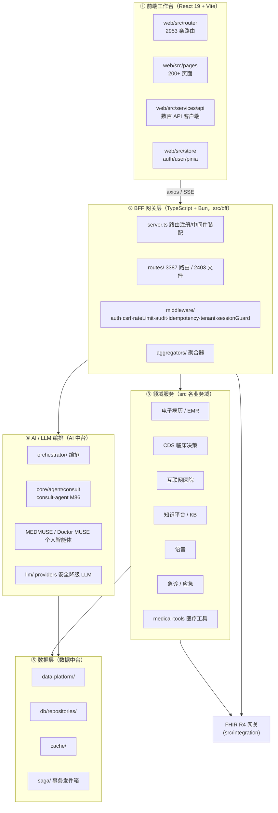

# 健澜AI原生医院操作系统OS — 架构审查报告

- 审查对象：仓库根 `C:\Users\lenovo\Doubao\chats\2026-09-14\new-chat-1`，分支 `consult-agent-m86`
- 审查时间：2026-11-01 19:06（UTC+8）
- 审查基线 HEAD：`0cddcdf9cbeb42f8d150d1bff36b38bb19e54ef7`（审查期间未 commit，HEAD 不变）
- 运行态：DEMO_MODE=1 离线；无 PostgreSQL / Redis / 真实 LLM；本轮未重启 BFF/Vite
- 依据文档：`ARCHITECTURE_CHARTER.md v2.0`（最高宪法）

> 产品名称规范：本报告一律使用「健澜AI原生医院操作系统OS」。"数智医院"仅作为行业转型背景词出现。

---

## 1. 现状分层图（Mermaid）

健澜AI原生医院操作系统OS 实际为五层 + 关键业务域。自上而下：



关键观察：
- BFF 是唯一对外 HTTP 入口；前端不直连数据库 / LLM。
- `consult-agent`（M86）链路已落地在 `src/core/agent/consult`，由 BFF `routes/consultAgentRoutes.ts` 装配，符合宪法第七章 Doctor MUSE / AI 辅助定位。
- `src/security` 独立成域：auth(RBAC) / audit / classification / compliance / desensitization / encryption / input / mfa，与宪法第五章生产安全对齐。

---

## 2. 模块依赖方向（import 方向）

实测规则与发现：

| 方向 | 路径 | 结论 |
|---|---|---|
| 前端 → BFF | `web/src/** → @/bff/*` | **类型-only**（`import type`），tsconfig `@/bff/* → ../src/bff/*`；vite 运行时别名 `@ → ./src`，`@/bff` 不参与打包，类型擦除后无运行时反向依赖。共 7 处（emr/qc 系列页面）。**可接受的共享类型边界**，非运行时反向依赖。 |
| BFF → 领域 | `src/bff/routes → src/core/agent/*`、`src/db/repositories/*` | 正向，符合 route→aggregator→repo→db 分层（宪法 §6.5）。 |
| BFF → 安全 | `src/bff/routes → src/bff/middleware/auth` | 正向。 |
| 领域 → BFF | 未发现 | 无 domain 层反向 import HTTP/BFF。 |
| 循环依赖 | 本次静态扫描未发现前端→业务运行时反向依赖；consult 域内部 consultAgentRoutes → core/agent/consult → db/repo 为单向。 | 通过。 |

> 说明：前端仅以 `import type` 共享 BFF 聚合器类型（`@/bff/aggregators/*`）。这是一种轻耦合，但建议后续把共享 DTO 下沉到独立 `shared/contracts` 包，使前端不再以 `@/bff/*` 为锚点——记入 backlog，本轮不改。

---

## 3. 数据流可追溯：一次 AI 辅助在线问诊

以 consult-agent M86 在线问诊为例（端到端已核对代码，非臆测）：

```
用户在 ConsultAgentChatPage 发消息
  → web/src/services/api/consultAgent.ts
      POST {apiBaseUrl}/consult-agent/threads/:threadId/stream   (fetch + SSE, Accept: text/event-stream)
  → BFF server.ts 匹配路由
      attachUser(c) 解析 Bearer JWT（HMAC-SHA256，验签 exp/nbf/iss）
      if (route.auth) requireAuth(c)          // 登录态
  → routes/consultAgentRoutes.ts #8
      requirePermissionCode(c, 'consult-agent:write')   // 细粒度权限码
      messageSendSchema.safeParse(content)               // zod 入参校验
      buildOrchestratorContext(c, repo, profile)
        → createConsultAgentRepo()  (db/repositories)
        → createSafeLlm()          (llm/ 安全降级)
        → createDefaultToolRegistry() (medical-tools)
      → handleConsultMessage(threadId, content, ctx)
          (src/core/agent/consult 编排：意图识别 → 安全分级 → 工具调用 → 草稿)
      → openSseStream(buildSseFrames(events), c)
          逐帧 delta / tool / draft / disclaimer / [DONE] 回推前端
```

非流式快照（`POST .../messages`）与回放（`GET .../stream/replay`）共用同一编排器，仅输出方式不同。审计事件经 `createAuditEntry` 落库（脱敏摘要，不回显原始入参，契约 §15）。

---

## 4. 与对标体系的缺口清单

对标：AI 原生医院 3.0 / 三中台（业务中台+数据中台+AI 中台）/ FHIR R4 网关 / CDS 深度 / 电子病历 6 级 / 智慧服务三级 / 互联互通四甲。

| 对标项 | 当前落地（实测） | 做到哪一步 | 缺口 |
|---|---|---|---|
| AI 原生 3.0（系统即学习系统） | 编排器 + 反馈闭环（adopted/modified/rejected）+ 个人智能体（Doctor/Nurse/Pharma/Admin MUSE）目录已建 | 骨架成型 | 跨就诊患者画像学习、被拒建议降权的在线策略尚未闭环（demo 仓库内内存态） |
| 业务中台 | 统一 RBAC / 用户 / 租户（src/tenant、src/security/auth），HIS/EMR/护理/药房/急诊路由齐全 | 中台身份与权限已统一 | 主数据（人员/科室/术语）治理仍以 demo 数据为主，未接真实主数据 |
| 数据中台 | src/data-platform、db/repositories、saga 发件箱、cache | 读模型 + 发件箱落地 | 实时数仓 / 指标平台 / 数据资产目录未在本轮代码中看到独立实现 |
| AI 中台 | orchestrator、llm/providers、core/agent、skills、tools 注册表 | 可编排 + 安全降级 LLM | 模型注册 / 灰度 / 漂移监测仅有看板（aiModelDriftV13），在线闭环待补 |
| FHIR R4 网关 | web 路由出现 fhir/patient、fhir/observation、fhir/condition、fhir/medicationrequest 等资源页；src/integration 存在 | 资源 CRUD 路由壳已建 | 术语绑定（LOINC/SNOMED）、Bundle/Subscription、跨系统互操作证书未在本轮验证 |
| CDS 深度 | cds/ 下 rule-engine、clinical-evidence、clinical-trials、guidelines、pathways、drugs-interaction、duplicate-therapy、drug-dose-adjust、lab-critical 等页面与 BFF cdsDeep 路由 | 规则引擎 + 证据/指南/路径界面齐全 | CDS 拦截率/override 留痕指标与真实规则库联动待压测 |
| 电子病历 6 级 | emr/ 下 homepage-board、templates、signatures、archives、emrGradeDashboard、emrQc 系列聚合器 | 五级评审、质控、签名、归档看板已建 | 六级要求的全流程数据闭环 / 闭环用药闭环校验，需以真实病历流验证 |
| 智慧服务三级 | smart-service/board（M479）、appointment/booking、complaint、elderly 等 | 服务看板与患者端流程壳已建 | 预约/分诊/支付/报告全流程患者体验指标未量化 |
| 互联互通四甲 | operationBenchmark、interoperability 看板、coreSystemBoard | 互操作看板占位 | 标准化评级所需的数据集标准化率 / 共享接口实测数据缺失 |

---

## 5. M3~M9xx 里程碑模块清单（实测扫描 src/ + web/src/）

> 实测：里程碑命名文件共 **997 个**，编号跨度 M1xx ~ **M912**。任务书范围 M3~M190 为宪法早期里程碑；本表按实际落盘的编号段汇总（含 M190-P0 合规改造）。

| 编号段 | 文件数 | 代表模块 | 状态判断 |
|---|---|---|---|
| M1xx | 4 | 基础脚手架、首个路由 | 已落地 |
| M2xx | 73 | 认证、权限、审计雏形 | 已落地 |
| M3xx | 94 | BFF 路由扩充、v13 报表族 | 已落地 |
| M4xx | 89 | CDS 深度、护理 NQI、质控、风险、安全合规、M470 患者时间线、M471 待办、M472-M488 各看板 | 已落地（看板族密集） |
| M5xx | 100 | M521 术前评估、性能/探测脚本 | 已落地 |
| M6xx | 100 | M615-M695 入院/检查/路径/耗材/投诉等业务模块 | 已落地 |
| M7xx | 100 | M700-M798 不良事件、ADR、烧伤、心内患者、校准等 | 已落地 |
| M8xx | 100 | M807-M899 各科室工作量看板（麻醉/心电/内镜/急诊/检验/放射…） | 已落地 |
| M9xx | 13 | M902/M906/M907 投诉/合同/审计工作量 | 进行中 |
| 专项 | — | M190-P0 合规改造（FHIR 网关、CDS 深度模块）、consult-agent M86（任务#30-#38 深化） | 本轮分支焦点 |

边界与缺口：
- 已落地模块多为「路由 + 页面 + 聚合器 + demo 数据」四件套；在 DEMO_MODE=1 下均为离线 mock，**未接真实 PG/LLM**。
- 缺口集中在「数据中台在线闭环」与「互联互通/电子病历六级的实测量化」，见 §4。

---

## 6. 本轮审查结论

1. 五层分层清晰，BFF 为唯一入口，无 domain→BFF 反向依赖，无前端运行时反向依赖。
2. consult-agent M86 前后端契约（12 端点）一致，权限码 READ/WRITE/AUDIT 落地正确。
3. 静态层面**未发现必须本轮就地修改的架构错误**（无循环依赖、无权限码错配、无新增品牌硬违规）。详见权限测试报告与修复记录。
4. backlog（不在本轮修改范围）：
   - web 路由存在约 150 组重复相对 path（详见权限报告），建议后续收敛；
   - BFF 存在 282 条 `auth:false` 与 86 条未显式声明 auth 的路由（多为 demo 报表/开放接口），建议逐项复核敏感度；
   - 前端 `import type` 直引 `@/bff/aggregators/*`，建议下沉共享 DTO。
