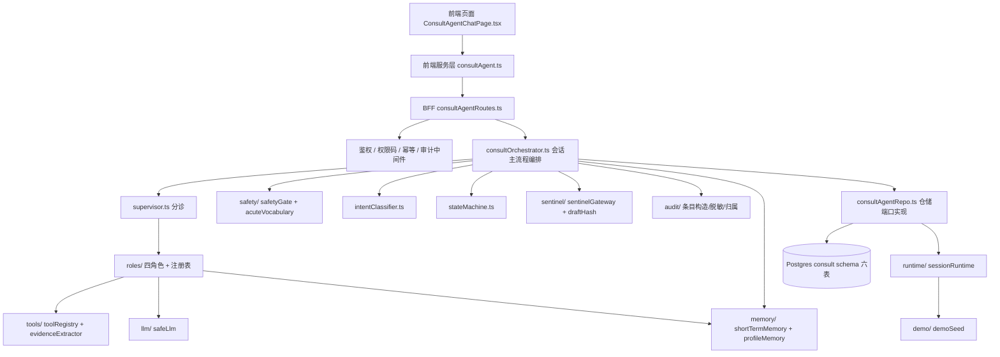
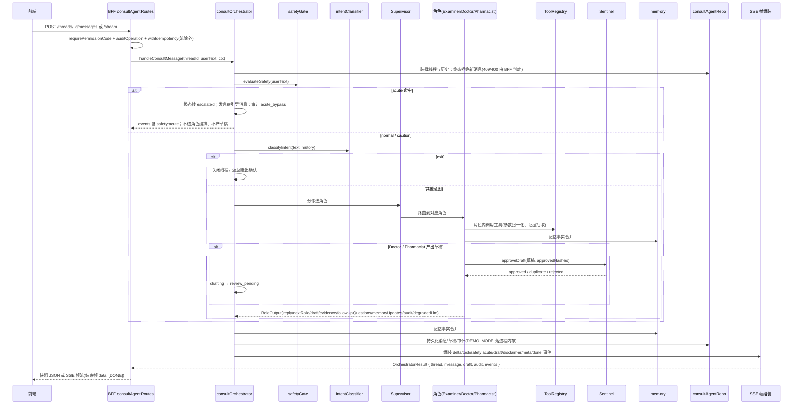

# consult-agent M86 架构设计说明

> Copyright (c) 2026 杭州健澜科技有限公司
>
> 模块：consult-agent（AI 辅助问诊助手）；所属产品：**健澜AI原生医院操作系统OS**。
> 架构分层、模块职责、依赖方向与数据流以冻结契约 `reports/consult-rebuild/CONTRACT-m86.md`
> §0、§5–§10、§12、§14 为准；工程范式对齐基线勘查档案 `reports/consult-rebuild/baseline-survey.md` §4。

## 1. 架构总览

consult-agent 采用「核心编排 + 角色插件 + 端口适配」的分层结构：核心包 `src/core/agent/consult/` 持有纯领域逻辑（状态机、意图、安全、角色、记忆、工具、哨兵、LLM 端口、DEMO 运行时）；BFF 层负责鉴权、权限码、幂等、审计、SSE 帧组装与响应封装；仓储层在 DEMO_MODE 短路到进程内存，非 DEMO 落 PostgreSQL `consult` schema；前端经服务层调用 BFF 并消费 SSE 事件。

分层依次为：core 编排（`consultOrchestrator` / `supervisor`）、roles（Supervisor / Examiner / Doctor / Pharmacist 四角色）、memory（短期记忆 / 画像）、tools（注册表 / 证据抽取）、sentinel（审批网关 / 哈希去重）、safety（急症词表 / 安全门）、llm（`safeLlm` 端口）、runtime（DEMO 会话内存）、BFF、前端、仓储、迁移。

分层与职责（契约 §0 文件树，顶层职责不得增删）：

| 层 | 目录 / 文件 | 职责 |
|---|---|---|
| 类型与契约 | `types.ts` | 全部枚举/接口/zod schema 单一来源 |
| 端口 | `ports.ts` | 角色/LLM/工具/仓储端口接口 |
| 状态机 | `stateMachine.ts` | 状态枚举 + 转移表 + `canTransition` / `assertTransition` |
| 意图 | `intentClassifier.ts` | 确定性意图分类（关键词规则 + 置信度） |
| 草稿哈希 | `draftHash.ts` | 稳定业务字段 SHA-256 草稿哈希 |
| 角色共享 | `roleSupport.ts` | 证据构造、免责声明、审计事件构造、常量 |
| 编排 | `supervisor.ts`、`consultOrchestrator.ts` | Supervisor 分诊实现；会话主流程编排（安全旁路 → 分诊 → 角色 → 哨兵 → 记忆 → 落库） |
| 角色 | `roles/index.ts`、`roles/supervisorRole.ts`、`roles/examinerRole.ts`、`roles/doctorRole.ts`、`roles/pharmacistRole.ts` | 角色注册表 + 统一 `RolePort` 类型导出；四角色实现 |
| 审计 | `audit/index.ts` | 审计条目构造/脱敏/归属（`actorRole` + `traceId` 透传） |
| LLM | `llm/safeLlm.ts` | 凭证仅取 `process.env`；无凭证确定性降级，不联网 |
| 记忆 | `memory/shortTermMemory.ts`、`memory/profileMemory.ts` | 近期消息 checkpoint（滑窗）；长期画像事实读写 |
| 运行时 | `runtime/sessionRuntime.ts` | DEMO_MODE 进程内会话/消息/草稿/画像内存存储与 DEMO 短路 |
| 安全 | `safety/acuteVocabulary.ts`、`safety/safetyGate.ts` | 急症词表 + 命中检测；安全等级评估与急症旁路判定 |
| 哨兵 | `sentinel/sentinelGateway.ts` | 审批网关 + 草稿哈希去重 |
| 工具 | `tools/toolRegistry.ts`、`tools/evidenceExtractor.ts` | 工具注册表（规范驼峰名 + 下划线别名 + 参数归一化）；证据抽取与分类 |
| 演示 | `demo/demoSeed.ts` | 演示种子（DEMO 引导文案/示例工具返回/规则快照基线） |
| 聚合导出 | `index.ts` | 包级聚合导出 |
| BFF | `src/bff/routes/consultAgentRoutes.ts` | 12 个 handler；鉴权、权限码、幂等、审计、SSE 帧 |
| 仓储 | `src/db/repositories/consultAgentRepo.ts` | 线程/消息/文档/草稿/审计/画像 `create/list/get/update`；`mapRow` 蛇形转驼峰 |
| 迁移 | `deploy/postgres/init/380-consult-threads.sql`、`381-consult-messages.sql`、`382-consult-documents.sql`、`383-consult-drafts.sql`、`384-consult-audit-trail.sql`、`385-consult-profile-memory.sql` | `consult` schema 六表 DDL 与权限种子（契约 §13） |
| 前端服务层 | `web/src/services/api/consultAgent.ts` | REST 调用 + SSE fetch + handler 回调 |
| 前端页面 | `web/src/pages/consult-agent/ConsultAgentChatPage.tsx` | 会话列表 + 消息流 + 工具折叠卡片 + 急症 Alert + 草稿面板 + 常驻免责声明 |

## 2. 模块依赖图

依赖方向自上而下：上层可依赖下层，下层不得反向依赖上层；核心包不直接依赖 BFF/HTTP/前端。

### 2.1 端口与适配器（契约 §5、§6、§9、§12）

- `RolePort`：`kind: RoleKind`；`handle(input: RoleInput): Promise<RoleOutput>`。
- `SafeLlmPort`：`isAvailable(): boolean`；`complete(prompt: string, role: RoleKind): Promise<{ text: string; degraded: boolean }>`。
- `ToolRegistry`：`register` / `resolve` / `normalizeArgs` / `invoke` / `list`；`ToolDescriptor` 含规范驼峰 `name`、`aliases`、`description`、`run`；`ToolResult` 含 `success`、`evidence`、`summary`、`errorClass`；`ToolContext` 含 `traceId`、`memory`。
- 仓储端口 `ConsultAgentPort` 由 `consultAgentRepo` 实现；`OrchestratorContext` 注入 `userId`、`traceId`、`repo`、`llm`、`tools`、`profile`（契约 §10）。

## 3. 端到端数据流

消息进入到 SSE 下发的固定顺序（契约 §10，禁止跳过安全旁路）：

### 3.1 编排步骤（契约 §10，顺序固定）

1. 装载线程与历史；线程终态拒绝新消息（409/400 由 BFF 判定）。
2. `evaluateSafety(userText)`：`acute` → 状态转 `escalated`，发急症引导系统/assistant 消息，审计 `acute_bypass`，事件 `safety:acute`，**不进入角色编排、不产草稿**，直接返回。
3. `classifyIntent`；`exit` → 关闭线程，返回退出确认。
4. Supervisor 分诊选角色；Examiner 追问 → `clarifying`；Doctor/Pharmacist 产出草稿 → Sentinel 审批 → `drafting` → `review_pending`。
5. 工具调用在角色内完成；审计记录工具摘要。
6. 记忆事实合并；持久化消息/草稿/审计（DEMO_MODE 落进程内存）。
7. 组装 `events`（`delta` / `tool` / `safety:acute` / `draft` / `disclaimer` / `meta` / `done`）。

### 3.2 SSE 帧格式（契约 §11）

- 帧格式：`data: {json}\n\n`；结束帧 `data: [DONE]\n\n`。
- 响应头复用 `SSE_HEADERS` 范式：`Content-Type: text/event-stream; charset=utf-8`、`Cache-Control: no-cache, no-transform`、`Connection: keep-alive`、`X-Accel-Buffering: no`。
- 流路由不消费 `Idempotency-Key`。

## 4. 与既有 BFF 范式对齐说明

| 既有范式（基线 §4） | consult-agent 对齐方式 |
|---|---|
| 路由模板 `src/bff/routes/academicExchangeV13.ts`：导出 `RouteDef[]`，`{ method, path, auth: true, handle }` | `consultAgentRoutes.ts` 同构导出 `RouteDef[]`；成功 `json(ok(payload, 'ok', c.traceId))`；失败 `json(fail(ErrorCode.X, 'msg', c.traceId), status)` |
| 权限守卫 `requirePermissionCode(c, code)`：返回 `null` 放行，否则 401（未登录）/403（权限不足）；`admin` 一律放行 | 写操作首步 `requirePermissionCode(c, 'consult-agent:write')`；读 `consult-agent:read`；审计 `consult-agent:audit` |
| 权限登记 `permissions.ts`：`XXX_PERMISSIONS` 常量对象 + 联合类型 + `ALL_XXX_PERMISSION_CODES` 数组 | 文件末尾追加 `CONSULT_AGENT_PERMISSIONS`、`ConsultAgentPermissionCode`、`ALL_CONSULT_AGENT_PERMISSION_CODES`，不改既有段（契约 §12） |
| 幂等中间件 `withIdempotency`：`Idempotency-Key` 8–200 字符；无头不改变行为；同键不同请求体冲突 | 写操作三件套之一；流式端点不挂幂等 |
| 审计中间件 `auditOperation(c)` fire-and-forget；`maskBody` 脱敏；`DEMO_MODE=1` 跳过 DB；异常不阻断主请求 | 写操作三件套之一；核心包内 `audit/index.ts` 另构造领域审计条目（`ConsultAuditEntry`）落 `consult.audit_trail` |
| SSE 模板 `medmuseStream.ts` / `chat.ts` / `assistantLlmChat.ts`：`ReadableStream<Uint8Array>` + `TextEncoder`，逐帧 `data: {json}\n\n`，结束帧 `data: [DONE]` | 流式端点与回放端点复用同一帧格式与 `SSE_HEADERS` |
| 仓储模板 `consultRequestRepo.ts`：接口字段驼峰；`db\`...RETURNING *\``；`mapRow` 蛇形转驼峰；`DEMO_MODE` 无真实连接 | `consultAgentRepo.ts` 签名风格对齐；`DEMO_MODE=1` 短路 `sessionRuntime` 进程内存 |
| 迁移模板 `99-nursing-risk-warning.sql`：`CREATE TABLE IF NOT EXISTS`、`uuid PRIMARY KEY DEFAULT gen_random_uuid()`、`jsonb`、`timestamptz DEFAULT now()`、`set_updated_at()` 触发器、头部注释含红线/权限码/幂等/Copyright | 380–385 编号、`consult` schema，规范逐条对齐（契约 §13） |
| 前端服务层 `aiConversation.ts`：`import { get, post } from '../request'`；token/CSRF；View 接口与 SSE 事件类型；错误经 `onError` 上报，不本地编造回复 | `consultAgent.ts` 同构；SSE 用原生 `fetch(env.apiBaseUrl + ...)`，携带 `Authorization: Bearer token` 与 `X-CSRF-Token`（契约 §14.1） |
| 权限包裹 `RequirePermission`；`AuthGuard` 包裹路由组 | 路由 `consult-agent/chat` 以 `consult-agent:read` 包裹（契约 §14.3） |

## 5. 关键架构约束

1. **安全旁路不可跳过**：`evaluateSafety` 在意图分类与角色编排之前执行；`acute` 直接旁路返回，不产生草稿（契约 §10.2、§15.2）。
2. **AI 不自主开医嘱**：草稿恒为 `pending_review`；`needsPhysicianReview=true`；处方 `isOutOfHospitalPrescription=false`；zod 字面量强制（契约 §1.3、§15.3）。
3. **工具审计不回显入参明文**：`ToolCallRecord` 仅保留 `callId/name/status/durationMs/evidenceCount/errorClass/summary`；`ConsultAuditEntry.detail` 为脱敏结构化摘要（契约 §1.2、§15.5）。
4. **LLM 不联网**：凭证仅取 `process.env`；当前实现不发起网络请求；降级文案带免责声明；审计记录 `degradedLlm: true`（契约 §9、§15.7）。
5. **核心包无 HTTP 依赖**：BFF 通过 `OrchestratorContext` 注入 `repo`、`llm`、`tools`、`profile`；核心逻辑可在单元测试中以 fake 端口直接断言（契约 §16 测试范式）。
6. **DEMO_MODE 短路边界**：`DEMO_MODE=1` 时仓储层不连库；`sessionRuntime` 提供进程内会话/消息/草稿/画像内存存储；演示种子提供引导文案、示例工具返回与规则快照基线（契约 §0、§12、§16）。
