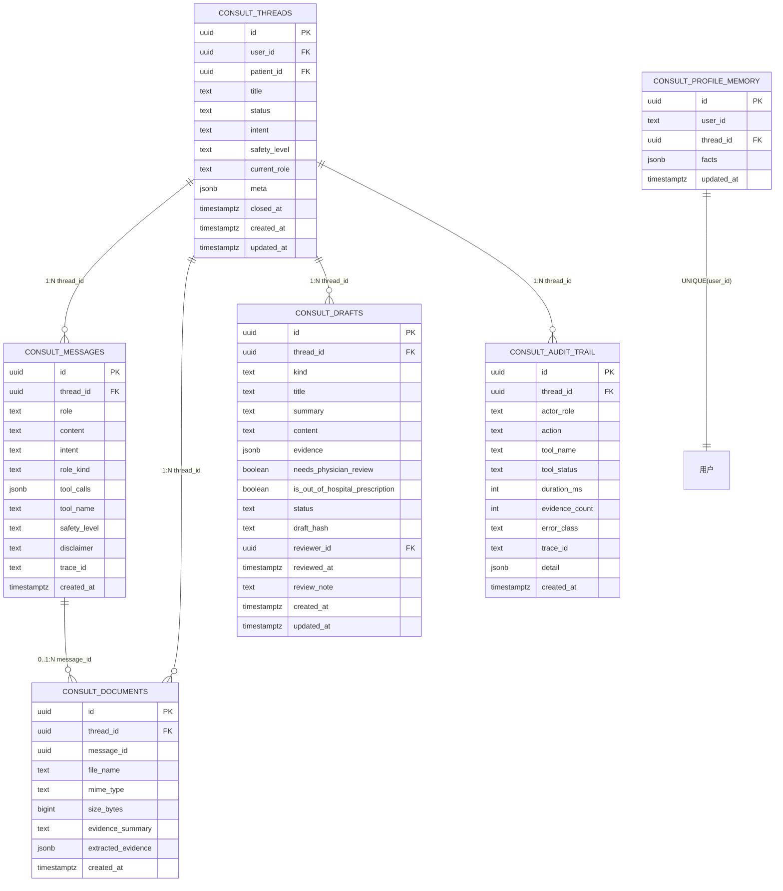

# consult-agent M86 数据模型说明

> Copyright (c) 2026 杭州健澜科技有限公司
>
> 所属产品：**健澜AI原生医院操作系统OS**。
> 六表结构、字段、约束、索引与关系以冻结契约 `reports/consult-rebuild/CONTRACT-m86.md`
> §1.2、§13 为准；字段名驼峰映射蛇形列，契约未定义的字段不得自行发明。

## 1. 模型总览

- Schema：`consult`；迁移编号 `380`–`385`，目录 `deploy/postgres/init/`。
- 实体与接口一一对应：`ConsultThread`、`ConsultMessage`、`ConsultDocument`、`ConsultDraft`（表 `diagnosis_prescription_drafts`）、`ConsultAuditEntry`、`ConsultProfileMemory`；`EvidenceItem`、`ProfileFact`、`ToolCallRecord` 作为 `jsonb` 内嵌结构存储。
- DDL 规范对齐 `deploy/postgres/init/99-nursing-risk-warning.sql`：`CREATE TABLE IF NOT EXISTS`、`uuid PRIMARY KEY DEFAULT gen_random_uuid()`、`jsonb`、`created_at/updated_at timestamptz DEFAULT now()`、`DROP TRIGGER IF EXISTS` + `CREATE TRIGGER ... public.set_updated_at()`、头部注释含医疗安全红线/权限码/幂等说明/Copyright；语句幂等可重入。

## 2. ER 关系图

## 3. 表结构明细

### 3.1 `consult.threads`（迁移 `380-consult-threads.sql`）

对应接口 `ConsultThread`。

> 接口字段 ↔ 列名：`id` ↔ `id`；`userId` ↔ `user_id`；`patientId` ↔ `patient_id`；`title` ↔ `title`；`status` ↔ `status`；`intent` ↔ `intent`；`safetyLevel` ↔ `safety_level`；`currentRole` ↔ `current_role`；`meta` ↔ `meta`；`closedAt` ↔ `closed_at`；`createdAt` ↔ `created_at`；`updatedAt` ↔ `updated_at`。

| 列 | 类型 | 约束 / 默认 | 说明 |
|---|---|---|---|
| `id` | uuid | PRIMARY KEY DEFAULT `gen_random_uuid()` | 会话 ID |
| `user_id` | uuid | NOT NULL；REFERENCES `iam.users(id)` | 归属登录用户 |
| `patient_id` | uuid | NULL；REFERENCES `clinical.patients(id)` | 关联患者，可空 |
| `title` | text | – | 会话标题 |
| `status` | text | CHECK ∈ `idle/collecting/clarifying/drafting/review_pending/escalated/closed/aborted` | 会话状态（`ThreadStatus`） |
| `intent` | text | CHECK ∈ `greeting/symptom_report/clarification_answer/medication_question/chronic_management/acute_emergency/document_upload/exit/unknown` | 最近意图（`IntentKind`） |
| `safety_level` | text | CHECK ∈ `normal/caution/acute` | 安全等级（`SafetyLevel`） |
| `current_role` | text | NULL；CHECK ∈ `supervisor/examiner/doctor/pharmacist` | 当前角色（`RoleKind`） |
| `meta` | jsonb | – | 扩展元数据 `Record<string, unknown>` |
| `closed_at` | timestamptz | NULL | 关闭时间 |
| `created_at` | timestamptz | DEFAULT `now()` | 创建时间 |
| `updated_at` | timestamptz | DEFAULT `now()`；`set_updated_at()` 触发器 | 更新时间 |

- 索引：`(user_id, updated_at DESC)`。
- 触发器：`DROP TRIGGER IF EXISTS` + `CREATE TRIGGER ... public.set_updated_at()`。

### 3.2 `consult.messages`（迁移 `381-consult-messages.sql`）

对应接口 `ConsultMessage`。

> 接口字段 ↔ 列名：`id` ↔ `id`；`threadId` ↔ `thread_id`；`role` ↔ `role`；`content` ↔ `content`；`intent` ↔ `intent`；`roleKind` ↔ `role_kind`；`toolCalls` ↔ `tool_calls`；`toolName` ↔ `tool_name`；`safetyLevel` ↔ `safety_level`；`disclaimer` ↔ `disclaimer`；`traceId` ↔ `trace_id`；`createdAt` ↔ `created_at`。

| 列 | 类型 | 约束 / 默认 | 说明 |
|---|---|---|---|
| `id` | uuid | PRIMARY KEY DEFAULT `gen_random_uuid()` | 消息 ID |
| `thread_id` | uuid | NOT NULL；FK → `consult.threads(id)` ON DELETE CASCADE | 所属会话 |
| `role` | text | CHECK ∈ `user/assistant/tool/system` | 消息角色（`MessageRole`） |
| `content` | text | – | 消息内容 |
| `intent` | text | NULL；CHECK ∈ `IntentKind` 九值 | 意图分类结果 |
| `role_kind` | text | NULL；CHECK ∈ `supervisor/examiner/doctor/pharmacist` | 产生该消息的编排角色 |
| `tool_calls` | jsonb | NULL；`ToolCallRecord[]` | 工具调用记录（不含原始入参明文） |
| `tool_name` | text | NULL | 关联工具规范名 |
| `safety_level` | text | CHECK ∈ `normal/caution/acute` | 安全等级 |
| `disclaimer` | text | – | 本条消息携带的免责声明 |
| `trace_id` | text | NOT NULL | 追踪 ID，审计透传 |
| `created_at` | timestamptz | DEFAULT `now()` | 创建时间 |

- 索引：`(thread_id, created_at ASC)`。

### 3.3 `consult.documents`（迁移 `382-consult-documents.sql`）

对应接口 `ConsultDocument`。

> 接口字段 ↔ 列名：`id` ↔ `id`；`threadId` ↔ `thread_id`；`messageId` ↔ `message_id`；`fileName` ↔ `file_name`；`mimeType` ↔ `mime_type`；`sizeBytes` ↔ `size_bytes`；`evidenceSummary` ↔ `evidence_summary`；`extractedEvidence` ↔ `extracted_evidence`；`createdAt` ↔ `created_at`。

| 列 | 类型 | 约束 / 默认 | 说明 |
|---|---|---|---|
| `id` | uuid | PRIMARY KEY DEFAULT `gen_random_uuid()` | 文档 ID |
| `thread_id` | uuid | NOT NULL；FK → `consult.threads(id)` | 所属会话 |
| `message_id` | uuid | NULL；FK → `consult.messages(id)` | 关联消息，可空 |
| `file_name` | text | NOT NULL | 文件名 |
| `mime_type` | text | – | MIME 类型 |
| `size_bytes` | bigint | NULL | 文件大小（字节） |
| `evidence_summary` | text | NULL | 证据摘要 |
| `extracted_evidence` | jsonb | –；`EvidenceItem[]` | 抽取证据 |
| `created_at` | timestamptz | DEFAULT `now()` | 创建时间 |

### 3.4 `consult.diagnosis_prescription_drafts`（迁移 `383-consult-drafts.sql`）

对应接口 `ConsultDraft`；表名按契约 §13 固定为 `diagnosis_prescription_drafts`。

> 接口字段 ↔ 列名：`id` ↔ `id`；`threadId` ↔ `thread_id`；`kind` ↔ `kind`；`title` ↔ `title`；`summary` ↔ `summary`；`content` ↔ `content`；`evidence` ↔ `evidence`；`needsPhysicianReview` ↔ `needs_physician_review`；`isOutOfHospitalPrescription` ↔ `is_out_of_hospital_prescription`；`status` ↔ `status`；`draftHash` ↔ `draft_hash`；`reviewerId` ↔ `reviewer_id`；`reviewedAt` ↔ `reviewed_at`；`reviewNote` ↔ `review_note`；`createdAt` ↔ `created_at`；`updatedAt` ↔ `updated_at`。

| 列 | 类型 | 约束 / 默认 | 说明 |
|---|---|---|---|
| `id` | uuid | PRIMARY KEY DEFAULT `gen_random_uuid()` | 草稿 ID |
| `thread_id` | uuid | NOT NULL；FK → `consult.threads(id)` | 所属会话 |
| `kind` | text | CHECK ∈ `diagnosis/prescription` | 草稿类型（`DraftKind`） |
| `title` | text | – | 草稿标题 |
| `summary` | text | – | 草稿摘要 |
| `content` | text | – | 草稿正文 |
| `evidence` | jsonb | –；`EvidenceItem[]` | 支撑证据 |
| `needs_physician_review` | boolean | NOT NULL DEFAULT `true`；CHECK (`needs_physician_review = true`) | 强制待医师复核 |
| `is_out_of_hospital_prescription` | boolean | NOT NULL DEFAULT `false`；CHECK (`is_out_of_hospital_prescription = false`) | 强制非院外处方 |
| `status` | text | CHECK (`status = 'pending_review'`) | AI 草稿恒为待复核 |
| `draft_hash` | text | NOT NULL | 稳定业务字段 SHA-256 十六进制 |
| `reviewer_id` | uuid | NULL；REFERENCES `iam.users(id)` | 复核医师 ID |
| `reviewed_at` | timestamptz | NULL | 复核时间 |
| `review_note` | text | NULL | 复核备注 |
| `created_at` | timestamptz | DEFAULT `now()` | 创建时间 |
| `updated_at` | timestamptz | DEFAULT `now()`；`set_updated_at()` 触发器 | 更新时间 |

- 索引：`(thread_id, kind)`。
- 唯一约束：`(thread_id, kind, draft_hash)`，配合 Sentinel 同线程同哈希去重（契约 §8）。

### 3.5 `consult.audit_trail`（迁移 `384-consult-audit-trail.sql`）

对应接口 `ConsultAuditEntry`。

> 接口字段 ↔ 列名：`id` ↔ `id`；`threadId` ↔ `thread_id`；`actorRole` ↔ `actor_role`；`action` ↔ `action`；`toolName` ↔ `tool_name`；`toolStatus` ↔ `tool_status`；`durationMs` ↔ `duration_ms`；`evidenceCount` ↔ `evidence_count`；`errorClass` ↔ `error_class`；`traceId` ↔ `trace_id`；`detail` ↔ `detail`；`createdAt` ↔ `created_at`。

| 列 | 类型 | 约束 / 默认 | 说明 |
|---|---|---|---|
| `id` | uuid | PRIMARY KEY DEFAULT `gen_random_uuid()` | 审计条目 ID |
| `thread_id` | uuid | NOT NULL；FK → `consult.threads(id)` | 所属会话 |
| `actor_role` | text | CHECK ∈ `supervisor/examiner/doctor/pharmacist/system/user` | 行为主体角色 |
| `action` | text | NOT NULL | 动作标识（如 `acute_bypass`、工具调用、草稿产出） |
| `tool_name` | text | NULL | 工具规范名 |
| `tool_status` | text | NULL；CHECK ∈ `success/error/skipped` | 工具状态 |
| `duration_ms` | integer | NULL | 耗时（毫秒） |
| `evidence_count` | integer | NULL | 证据条数 |
| `error_class` | text | NULL | 错误分类 |
| `trace_id` | text | NOT NULL | 追踪 ID |
| `detail` | jsonb | – | 脱敏后的结构化摘要，禁止原始入参 |
| `created_at` | timestamptz | DEFAULT `now()` | 创建时间 |

- 索引：`(thread_id, created_at ASC)`、`(trace_id)`。

### 3.6 `consult.profile_memory`（迁移 `385-consult-profile-memory.sql`）

对应接口 `ConsultProfileMemory`。

> 接口字段 ↔ 列名：`id` ↔ `id`；`userId` ↔ `user_id`；`threadId` ↔ `thread_id`；`facts` ↔ `facts`；`updatedAt` ↔ `updated_at`。

| 列 | 类型 | 约束 / 默认 | 说明 |
|---|---|---|---|
| `id` | uuid | PRIMARY KEY DEFAULT `gen_random_uuid()` | 画像记录 ID |
| `user_id` | text | NOT NULL；UNIQUE | 归属用户（一用户一条画像） |
| `thread_id` | uuid | NULL；FK → `consult.threads(id)` ON DELETE SET NULL | 关联会话，可空 |
| `facts` | jsonb | –；`ProfileFact[]` | 画像事实集合 |
| `updated_at` | timestamptz | DEFAULT `now()`；`set_updated_at()` 触发器 | 更新时间 |

- `ProfileFact` 内嵌结构：`{ key: string; value: string; source: string; updatedAt: string }`；事实键例：`allergy`、`chronic_condition`、`drug_intolerance`、`preferred_language`。
- 本表无 `created_at` 列（接口 `ConsultProfileMemory` 未定义该字段，不新增）。

## 4. 内嵌 jsonb 结构

### 4.1 `EvidenceItem`

| 字段 | 类型 | 说明 |
|---|---|---|
| `kind` | string | `knowledge` / `drug` / `allergy` / `interaction` / `history` / `document` |
| `label` | string | 证据标题 |
| `source` | string | 证据来源 |
| `snippet` | string | 证据摘要片段 |

### 4.2 `ToolCallRecord`

| 字段 | 类型 | 说明 |
|---|---|---|
| `callId` | string | 调用标识 |
| `name` | string | 工具规范驼峰名 |
| `status` | `ToolStatus` | `success` / `error` / `skipped` |
| `durationMs` | number | 耗时（毫秒） |
| `evidenceCount` | number | 证据条数 |
| `errorClass` | string \| null | 错误分类 |
| `summary` | string \| null | 工具摘要 |

> 禁止保存/回显原始入参明文（契约 §1.2、§15.5）。

## 5. 关系与级联规则

- `threads.user_id` REFERENCES `iam.users(id)`；`threads.patient_id` REFERENCES `clinical.patients(id)`，可空（契约 §13，380）。
- `messages.thread_id` FK ON DELETE CASCADE：会话删除时消息级联删除（契约 §13，381）。
- `documents.thread_id` FK → `threads`；`documents.message_id` 可空 FK → `messages(id)`（契约 §13，382）。
- `diagnosis_prescription_drafts.thread_id` FK → `threads`；`reviewer_id` REFERENCES `iam.users(id)`，可空（契约 §13，383）。
- `audit_trail.thread_id` FK → `threads`（契约 §13，384）。
- `profile_memory.user_id` UNIQUE：一用户一条画像；`thread_id` 可空 FK → `threads(id)` ON DELETE SET NULL（契约 §13，385）。
- 跨表追溯链路：`thread_id` 串联 `messages` / `documents` / `diagnosis_prescription_drafts` / `audit_trail`；`trace_id` 在 `messages` 与 `audit_trail` 之间透传（契约 §5.2、§15.6）。

## 6. 权限种子（迁移末段，契约 §13）

各迁移末段幂等写入 `iam.permissions` 三条权限码与角色授权，`ON CONFLICT (code) DO NOTHING` / `WHERE NOT EXISTS`：

| 权限码 | admin | doctor | nurse |
|---|---|---|---|
| `consult-agent:read` | ✓ | ✓ | ✓ |
| `consult-agent:write` | ✓ | ✓ | – |
| `consult-agent:audit` | ✓ | – | – |

- `audit` 权限仅授予 admin；doctor 持有 read+write；nurse 仅 read；admin 全量。
- 迁移头部注释含医疗安全红线、权限码、幂等说明与 `Copyright (c) 2026 杭州健澜科技有限公司`。

## 7. DEMO_MODE 存储边界

- `DEMO_MODE=1`：`consultAgentRepo` 短路到 `runtime/sessionRuntime` 进程内 Map，不连库；六表 DDL 不参与演示模式读写。
- 非 DEMO 模式：仓储层按本表结构读写；字段驼峰、`mapRow` 蛇形转驼峰；签名风格对齐 `consultRequestRepo.ts`（契约 §12）。
