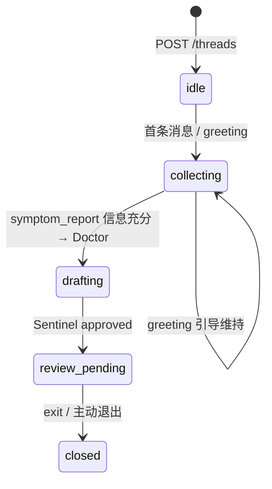
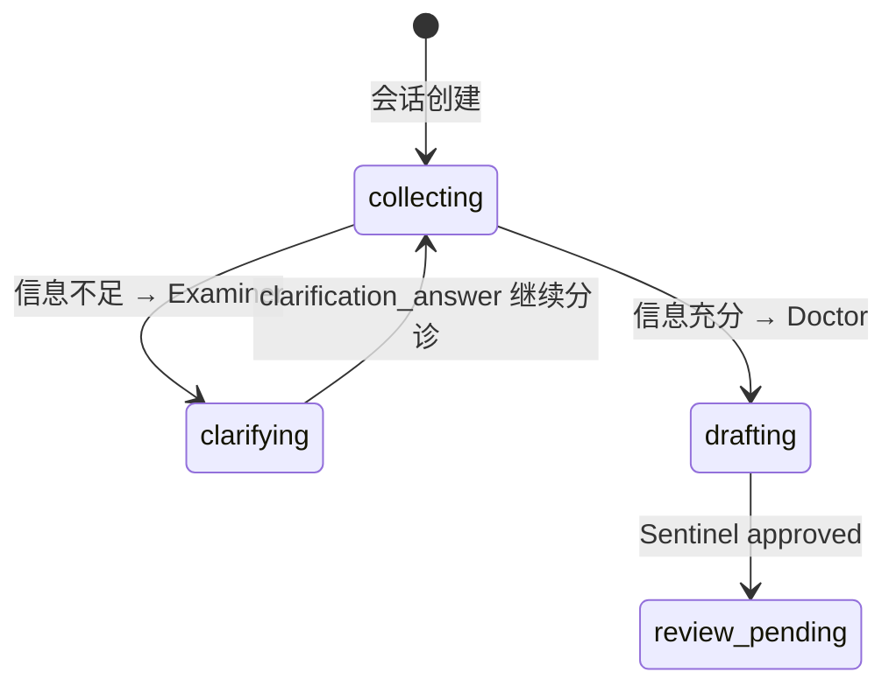
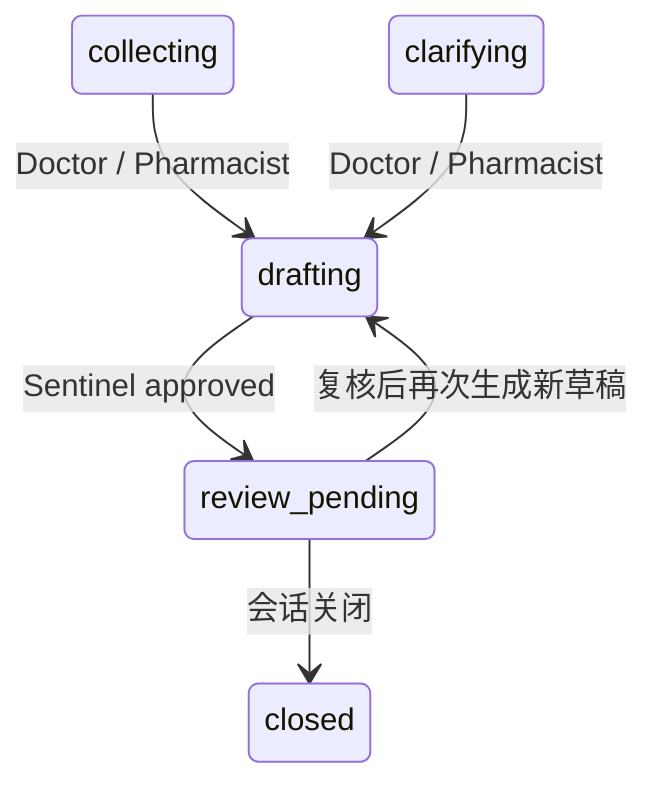
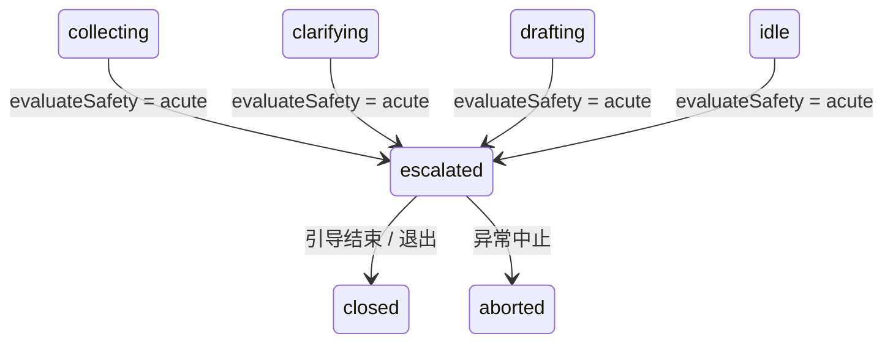
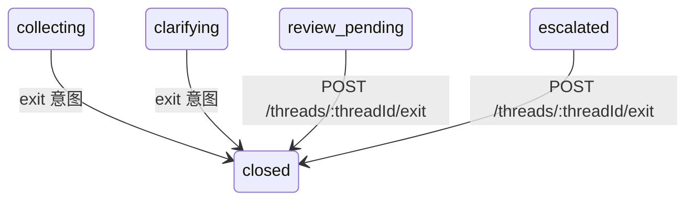

# consult-agent M86 会话状态机说明

> Copyright (c) 2026 杭州健澜科技有限公司
>
> 所属产品：**健澜AI原生医院操作系统OS**。
> 状态枚举、转移表与旁路规则以冻结契约 `reports/consult-rebuild/CONTRACT-m86.md`
> §1.1、§2、§5、§10 为准；非法转移必须显式抛错，不得静默跳转。

## 1. 状态枚举（`ThreadStatus`，契约 §1.1）

```ts
export type ThreadStatus =
  | 'idle' | 'collecting' | 'clarifying' | 'drafting'
  | 'review_pending' | 'escalated' | 'closed' | 'aborted';
```

| 状态 | 含义 |
|---|---|
| `idle` | 会话已创建，尚未进入采集 |
| `collecting` | 信息采集中（Supervisor 分诊 / 问候引导维持态） |
| `clarifying` | Examiner 追问中，等待用户补充信息 |
| `drafting` | Doctor / Pharmacist 正在生成草稿 |
| `review_pending` | 草稿待执业医师复核（AI 草稿恒为此态） |
| `escalated` | 急症旁路已触发，会话退出常规问诊编排 |
| `closed` | 终态：用户主动退出 / 正常关闭 |
| `aborted` | 终态：异常中止 |

## 2. 完整转移表（契约 §2，`stateMachine.ts`）

```ts
export const THREAD_TRANSITIONS: Record<ThreadStatus, ThreadStatus[]> = {
  idle:           ['collecting', 'escalated', 'closed'],
  collecting:     ['clarifying', 'drafting', 'escalated', 'closed', 'aborted'],
  clarifying:     ['collecting', 'drafting', 'escalated', 'closed', 'aborted'],
  drafting:        ['review_pending', 'escalated', 'closed', 'aborted'],
  review_pending: ['drafting', 'closed', 'aborted'],
  escalated:      ['closed', 'aborted'],
  closed:         [],
  aborted:        [],
};

export function canTransition(from: ThreadStatus, to: ThreadStatus): boolean;
export function assertTransition(from: ThreadStatus, to: ThreadStatus): void; // 非法转移抛 Error
```

### 2.1 允许转移矩阵

| 源状态 ↓ / 目标状态 → | `idle` | `collecting` | `clarifying` | `drafting` | `review_pending` | `escalated` | `closed` | `aborted` |
|---|---|---|---|---|---|---|---|---|
| `idle` | – | ✓ | – | – | – | ✓ | ✓ | – |
| `collecting` | – | – | ✓ | ✓ | – | ✓ | ✓ | ✓ |
| `clarifying` | – | ✓ | – | ✓ | – | ✓ | ✓ | ✓ |
| `drafting` | – | – | – | – | ✓ | ✓ | ✓ | ✓ |
| `review_pending` | – | – | – | ✓ | – | – | ✓ | ✓ |
| `escalated` | – | – | – | – | – | – | ✓ | ✓ |
| `closed` | – | – | – | – | – | – | – | – |
| `aborted` | – | – | – | – | – | – | – | – |

### 2.2 状态转移约束

- `canTransition(from, to)` 返回布尔值；`assertTransition(from, to)` 在非法转移时抛 `Error`，由编排层与 BFF 调用方捕获处理。
- 终态 `closed`、`aborted` 出边为空；终态会话拒绝新消息（409/400 由 BFF 判定，契约 §10.1）。
- `review_pending` 不允许直接转入 `escalated`：急症旁路仅在新消息经 `evaluateSafety` 判定后、且源状态在允许集合内时触发。
- 表中未列出的转移一律非法，不得在角色或工具层绕过状态机直接改写 `status`。

## 3. 急症旁路规则（契约 §2、§4、§10.2、§15.2）

1. **优先级最高**：急症 `escalated` 旁路优先于任何角色编排；编排器在 `classifyIntent` 与角色分发之前先执行 `evaluateSafety(userText)`。
2. **判定**：`safetyGate.evaluateSafety(text)` 命中 `ACUTE_KEYWORDS` 词表 → `level = 'acute'`；含高危但非急危重表述 → `caution`；其余 `normal`。
3. **旁路动作**（`acute` 命中后固定执行）：
   - 状态由当前允许的源状态转入 `escalated`；
   - 发送急症引导系统/assistant 消息，文案为 `ACUTE_GUIDANCE`；
   - 审计 `acute_bypass`，透传 `traceId`；
   - 下发 SSE 事件 `safety:acute`（`matched: string[]`、`guidance: string`）；
   - **不进入角色编排、不产草稿**，直接返回 `OrchestratorResult`。
4. **旁路后**：`escalated` 仅可转入 `closed` 或 `aborted`；不允许回到 `collecting` / `clarifying` / `drafting` / `review_pending`。
5. 词表（契约 §4.1，可按测试需要扩充但不得删除；中文为主，小写归一化匹配）：
   `胸痛`、`胸闷伴大汗`、`呼吸困难`、`喘憋`、`意识丧失`、`昏迷`、`意识不清`、`偏瘫`、`口角歪斜`、`言语不清`、`中风`、`脑出血`、`抽搐`、`惊厥`、`大出血`、`呕血`、`咯血`、`黑便`、`便血`、`严重外伤`、`头部外伤`、`窒息`、`喉头水肿`、`严重过敏`、`过敏性休克`、`自杀`、`轻生`、`自伤`、`孕妇腹痛`、`阴道出血`、`胎动消失`、`高热惊厥`、`心肌梗死`、`心跳骤停`、`面色青紫`、`休克`、`剧烈腹痛`、`中毒`、`误服药物`。

## 4. 终态规则

| 终态 | 进入路径 | 后续行为 |
|---|---|---|
| `closed` | `idle` / `collecting` / `clarifying` / `drafting` / `review_pending` / `escalated` 转入；`exit` 意图关闭会话；退出端点 `POST /threads/:threadId/exit` | 拒绝新消息；消息/草稿/审计保留可查；`closed_at` 写入关闭时间 |
| `aborted` | `collecting` / `clarifying` / `drafting` / `review_pending` / `escalated` 转入；异常中止 | 拒绝新消息；审计留痕中止原因；不允许复活 |

- 终态会话的历史消息、草稿、审计轨迹仍可经 `consult-agent:read` / `consult-agent:audit` 权限查询。
- 终态判定在编排器装载线程后第一步执行；非法终态转移由 `assertTransition` 抛错兜底。

## 5. 意图与状态映射（契约 §3、§5、§10）

| 意图 / 触发 | 状态动作 | 角色 |
|---|---|---|
| `greeting` | 维持 `collecting`，输出简短引导 | Supervisor |
| `symptom_report`（信息充分） | `collecting` / `clarifying` → `drafting` | Doctor |
| `symptom_report`（信息不足） | `collecting` → `clarifying` | Examiner |
| `clarification_answer` | `clarifying` → `collecting`（继续分诊）或 → `drafting`（信息已充分） | Supervisor → Doctor / Pharmacist |
| `medication_question` | `collecting` / `clarifying` → `drafting` | Pharmacist |
| `chronic_management` | `collecting` 内分诊，必要时 `clarifying` | Supervisor → 对应角色 |
| `document_upload` | 证据抽取后回到 `collecting` / `clarifying` | Supervisor |
| `acute_emergency` | 旁路转入 `escalated`（不进角色） | 编排层 |
| `exit` | 转入 `closed` | 编排层 |
| `unknown` | 维持 `collecting`，引导补充信息 | Supervisor |

## 6. 典型时序

### 6.1 普通问诊（问候 → 症状主诉 → 信息充分）



1. 创建会话：`idle`。
2. 首条问候消息：Supervisor 简短引导，状态维持 `collecting`，下发 `disclaimer` 事件。
3. 用户陈述症状且信息充分：Supervisor 分诊到 Doctor；状态 `collecting` → `drafting`。
4. Doctor 调用工具取证据，产出诊断草稿；Sentinel `approved`；状态 `drafting` → `review_pending`；下发 `draft` 事件。
5. 用户退出：`review_pending` → `closed`。

### 6.2 信息不足追问（采集 → 追问 → 补充 → 草稿）



1. 用户主诉关键信息缺失：Supervisor 分诊到 Examiner；`collecting` → `clarifying`。
2. Examiner 输出 2–4 个结构化追问（`followUpQuestions`），不产草稿。
3. 用户补充回答（`clarification_answer`）：`clarifying` → `collecting`，Supervisor 重新分诊。
4. 信息充分后转入 `drafting`，产出草稿进入 `review_pending`。

### 6.3 出草稿复核（Doctor / Pharmacist 两条草稿路径）



- Doctor 草稿 `kind=diagnosis`；Pharmacist 草稿 `kind=prescription`；两者均 `needsPhysicianReview=true`、`status='pending_review'`；处方草稿 `isOutOfHospitalPrescription=false`。
- Sentinel 判定：同线程同 `draftHash` 已审批 → `duplicate`，返回既有草稿，不重复审批、不重复落库；缺证据、安全等级 `acute`、违背红线 → `rejected`；其余 → `approved`（契约 §8）。
- `review_pending` → `drafting` 仅用于医师复核后再次生成新草稿；AI 不产生 `approved` / `rejected` 自身状态。

### 6.4 急症旁路（任意常规状态 → escalated → closed）



1. 用户消息命中急症词表：编排器在角色编排前判定 `acute`。
2. 状态转入 `escalated`；发送 `ACUTE_GUIDANCE` 引导消息；审计 `acute_bypass`；下发 `safety:acute` 事件。
3. 不调用角色、不调用工具、不产草稿。
4. 会话后续仅可 `closed` 或 `aborted`。

### 6.5 退出会话（`exit` 意图 / 退出端点）



1. 用户输入 `exit` 意图关键词（结束/退出/再见/不用了/关闭会话）：编排器关闭线程，返回退出确认。
2. 或前端调用 `POST /threads/:threadId/exit`（`consult-agent:write`，幂等 + 审计）：状态转入 `closed`，返回 `{ thread }`。
3. 终态后拒绝新消息；历史记录可查询。

## 7. 状态机实现约束

- 状态机为纯函数模块 `stateMachine.ts`：`canTransition` / `assertTransition` 不依赖仓储与 LLM，单元测试可直接断言（契约 §16）。
- 所有状态改写必须经 `assertTransition` 校验；角色 `RoleOutput` 不直接回写线程状态，由编排器统一转移。
- 状态变更与消息、草稿、审计在同一编排步骤内落库；DEMO_MODE 落 `sessionRuntime` 进程内存（契约 §10.6、§12）。
